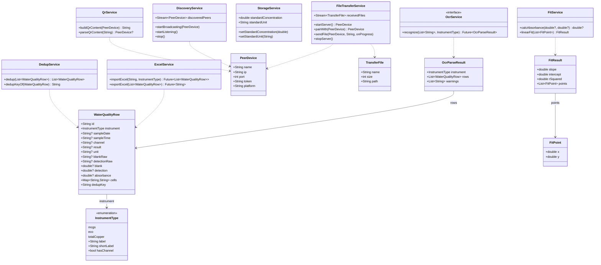
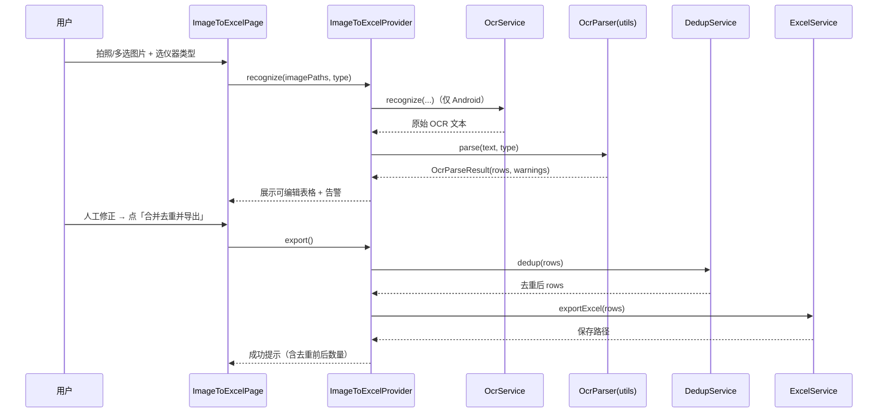
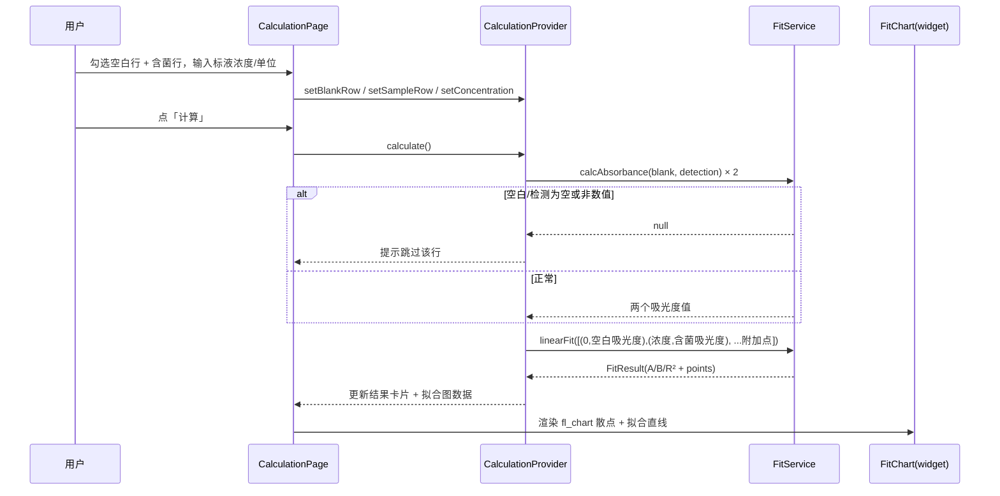
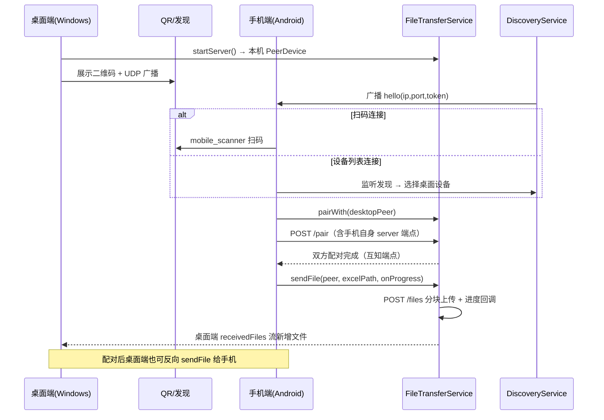

# 水质检测仪助手 — 系统架构设计 + 任务分解

> 架构师：高见远（Bob）
> 输入：`docs/PRD.md`（已确认 PRD）
> 技术栈：Flutter / Dart 单代码库，Android 手机端 + Windows 桌面端响应式
> 配色：主色 `#1976D2`，浅蓝底 `#E3F2FD`，辅以白/中性灰

---

## 1. 技术选型与理由

| 能力 | 选型 | 理由 |
| --- | --- | --- |
| OCR | `google_mlkit_text_recognition`（**仅 Android**） | 离线、免费、中文+数字识别好；PRD 指定首选。**桌面端不可用**，故桌面端不集成 OCR，改为导入已有 Excel（PRD 决策 4）。 |
| 相机 / 相册 | `image_picker` | 官方插件，Android 端拍照与多选稳定。桌面端无需选图（不做 OCR）。 |
| 文件选择 / 保存 | `file_picker` | 跨平台（Android + Windows）统一 API，既支持打开文件也支持 `saveFile()` 另存对话框，一个包覆盖两端。 |
| Excel 读写 | `excel` | 纯 Dart、无许可证风险；`syncfusion_flutter_xlsio` 需商用授权，故不采用（PRD 提示）。 |
| 图表 | `fl_chart` | 纯 Dart、全平台可用、MIT 许可、无授权坑；支持散点 + 拟合直线，满足「绘制拟合图像」。 |
| 二维码（展示） | `qr_flutter` | 纯 Dart，桌面端可稳定渲染二维码（内容 = IP+端口+token）。 |
| 二维码（扫描） | `mobile_scanner` | Android 端扫码连接，PRD 指定。桌面端不需要扫描。 |
| 网络传输 | `dart:io` 内置 `HttpServer` + `RawDatagramSocket`(UDP) | 文件级传输用 HTTP 分块上传最稳；发现用 UDP 广播，均为 SDK 内置，零额外依赖、零许可风险。 |
| 本机 IP 获取 | `dart:io` `NetworkInterface.list()` | 内置，跨平台，无需 `network_info_plus`（后者在 Windows 上有权限/易变坑）。 |
| 状态管理 | `provider` | 轻量、易测、与 ChangeNotifier 契合；本应用 4 个页面、3 个业务模块，用 provider 足够，避免 Riverpod/Bloc 的学习与样板成本。 |
| 本地存储 | `shared_preferences` | 仅需存少量设置（标液浓度、单位、协议偏好）；P2 历史记录可后续用 JSON 文件或 `hive` 扩展，MVP 不引入数据库。 |
| 唯一 ID / token | `uuid` | 生成配对 token、行 ID，稳定无碰撞。 |
| 路径处理 | `path` + `path_provider` | 跨平台路径拼接与临时/保存目录定位。 |

> 版本建议见第 7 节；实际以 `flutter pub add <pkg>` 解析到的最新兼容版本为准（本机 Dart SDK `^3.13.4` 较新）。

### 关键架构决策

1. **单一代码库 + 平台守卫**：OCR 仅 `Platform.isAndroid` 可用，所有 OCR 调用前用平台守卫拦截；桌面端「图片转 Excel」页降级为「导入已有 Excel」。
2. **业务逻辑与 UI 解耦**：`services/`（纯逻辑，可单测）+ `providers/`（ChangeNotifier 状态）+ `pages/`/`widgets/`（UI）。服务层不依赖 Flutter widget，便于测试与复用。
3. **文件级传输对称设计**：配对后双方互报各自 HTTP 服务器端点，因此**任一端都能向对端发文件**（满足 PRD「任一端可选文件发送」）。
4. **去重键统一**：`采样日期 + 采样时间 + 通道`；无「通道」字段的仪器用「仪器类型简称」代替（PRD 决策 5）。

---

## 2. 目录 / 文件结构

```
lib/
├── main.dart                         # 入口：runApp + 初始化 Provider
├── app.dart                          # MaterialApp + 主题 + 路由 + 导航壳
├── core/
│   ├── constants.dart                # 常量：配色、协议版本、端口、默认标液浓度/单位、QR 格式
│   ├── theme.dart                    # 蓝白主题（#1976D2 / #E3F2FD）
│   └── platform.dart                 # 平台判断工具（isAndroid/isWindows/isDesktop）
├── models/
│   ├── instrument_type.dart          # 仪器类型枚举 + 列映射元数据
│   ├── water_quality_row.dart        # 水质数据行（通用列 + 去重键）
│   ├── ocr_parse_result.dart         # OCR 解析结果 + 告警
│   ├── fit_result.dart               # 拟合结果（A/B/R² + 散点）
│   ├── peer_device.dart              # 对端设备（发现/配对）
│   └── transfer_file.dart            # 传输文件元信息 + 进度
├── services/
│   ├── ocr_service.dart              # OCR 识别（仅 Android，桌面抛不支持）
│   ├── excel_service.dart            # Excel 生成 / 导入
│   ├── dedup_service.dart            # 去重
│   ├── fit_service.dart              # 吸光度计算 + 线性拟合
│   ├── storage_service.dart          # shared_preferences 封装（标液浓度/单位等）
│   ├── file_transfer_service.dart    # HTTP Server + Client（配对/收发文件）
│   ├── discovery_service.dart        # UDP 广播发现
│   └── qr_service.dart               # 二维码内容构造/解析
├── providers/
│   ├── image_to_excel_provider.dart  # 图片转 Excel 状态
│   ├── calculation_provider.dart     # 大肠杆菌计算状态
│   └── transfer_provider.dart        # 数据传输状态
├── pages/
│   ├── shell_page.dart               # 响应式导航壳（手机底部 / 桌面左侧）
│   ├── home_page.dart                # 首页：功能入口卡片
│   ├── image_to_excel_page.dart      # 图片转 Excel
│   ├── calculation_page.dart         # 大肠杆菌计算
│   └── settings_page.dart            # 设置 / 数据传输
├── widgets/
│   ├── responsive_navigation.dart    # NavigationBar / NavigationRail 封装
│   ├── editable_result_table.dart    # 可编辑识别结果表格（P1-2）
│   ├── fit_chart.dart                # fl_chart 拟合图
│   ├── qr_code_card.dart             # 二维码展示卡片
│   ├── file_list_tile.dart           # 传输文件列表项（含进度）
│   └── status_badge.dart             # 语义状态徽标（成功/警示/错误）
└── utils/
    ├── ocr_parser.dart               # OCR 文本 → 结构化行（按仪器类型）
    ├── number_utils.dart             # 数值解析（含「未检出」/空处理）
    └── result_validator.dart         # 空白/检测列校验与跳过提示
```

> 平台原生配置改动（AndroidManifest 相机权限、Windows 无需额外配置）在对应任务的「要点」中说明。

---

## 3. 核心数据模型（Dart class 定义）

```dart
// ---------- models/instrument_type.dart ----------
enum InstrumentType {
  mcgs('总大肠菌群检测仪', 'MCGS', hasChannel: false),
  eco('在线水质分析仪', 'E.co', hasChannel: true),
  totalCopper('总铜在线分析仪', '总铜', hasChannel: false);

  const InstrumentType(this.label, this.shortLabel, {required this.hasChannel});
  final String label;       // 全称
  final String shortLabel;  // 用于去重键与展示
  final bool hasChannel;    // 是否有「通道」字段
}

// ---------- models/water_quality_row.dart ----------
class WaterQualityRow {
  WaterQualityRow({
    required this.id,
    required this.instrument,
    this.sampleDate,
    this.sampleTime,
    this.channel,
    this.result,
    this.unit,
    this.blankRaw,
    this.detectionRaw,
    this.blank,
    this.detection,
    this.absorbance,
    Map<String, String>? cells,
  }) : cells = cells ?? {};

  final String id;                    // uuid，编辑/勾选锚点
  final InstrumentType instrument;    // 来源仪器
  String? sampleDate;                 // 采样日期
  String? sampleTime;                 // 采样时间
  String? channel;                    // 通道（E.co 才有）
  String? result;                     // 分析结果 / 总大肠杆菌 / 数据结果
  String? unit;                       // 单位（MPN/L 等）
  String? blankRaw;                   // 空白原始文本
  String? detectionRaw;               // 检测原始文本
  double? blank;                      // 空白数值（已解析，可为 null=异常）
  double? detection;                  // 检测数值
  double? absorbance;                 // 吸光度（总铜自带，或计算得到）
  final Map<String, String> cells;    // 全部列原始值，供可编辑表格展示

  // 去重键：采样日期 + 采样时间 + 通道(无通道用仪器简称)
  String get dedupKey =>
      '${sampleDate ?? ''}|${sampleTime ?? ''}|${channel ?? instrument.shortLabel}';
}

// ---------- models/ocr_parse_result.dart ----------
class OcrParseResult {
  OcrParseResult({required this.instrument, required this.rows, this.warnings = const []});
  final InstrumentType instrument;
  final List<WaterQualityRow> rows;
  final List<String> warnings;        // 跳过/异常提示（面向用户）
}

// ---------- models/fit_result.dart ----------
class FitPoint {
  FitPoint(this.x, this.y);
  final double x;  // 标液浓度 / 0
  final double y;  // 吸光度
}

class FitResult {
  FitResult({required this.slope, required this.intercept, required this.rSquared, required this.points});
  final double slope;      // a，展示为 B
  final double intercept;  // b，展示为 A
  final double rSquared;   // R²
  final List<FitPoint> points;
}

// ---------- models/peer_device.dart ----------
class PeerDevice {
  PeerDevice({required this.name, required this.ip, required this.port, required this.token, required this.platform});
  final String name;      // 设备名
  final String ip;        // IPv4
  final int port;         // HTTP 服务器端口
  final String token;     // 配对鉴权 token
  final String platform;  // android / windows
}

// ---------- models/transfer_file.dart ----------
class TransferFile {
  TransferFile({required this.name, required this.size, required this.path});
  final String name;   // 文件名
  final int size;      // 字节
  final String path;   // 本地路径
}

class TransferProgress {
  TransferProgress({required this.fileName, required this.sent, required this.total});
  final String fileName;
  final int sent;
  final int total;
  double get ratio => total == 0 ? 0 : sent / total;
}
```

---

## 4. 关键接口与类设计

```dart
// ---------- services/ocr_service.dart ----------
/// 仅 Android 可用；桌面端调用应抛 UnsupportedError。
abstract class OcrService {
  /// 识别一组图片并按仪器类型解析为结构化行。
  Future<OcrParseResult> recognize(List<String> imagePaths, InstrumentType type);
}

// ---------- services/excel_service.dart ----------
class ExcelService {
  /// 导入既有 Excel → 结构化行（桌面端入口，仪器类型由用户指定）。
  Future<List<WaterQualityRow>> importExcel(String path, InstrumentType type);

  /// 导出（去重后）行到 Excel，返回保存路径；dir 为空则弹保存对话框。
  Future<String> exportExcel(List<WaterQualityRow> rows, {String? dir});
}

// ---------- services/dedup_service.dart ----------
class DedupService {
  /// 整行相同即去重，判定键 = dedupKey。
  List<WaterQualityRow> dedup(List<WaterQualityRow> rows);
  String dedupKeyOf(WaterQualityRow row);
}

// ---------- services/fit_service.dart ----------
class FitService {
  /// 吸光度 = ln(空白/检测)*10000；空白<检测时 = ln(检测/空白)*10000。
  /// 任一为空/非数值返回 null（由上层跳过并提示）。
  double? calcAbsorbance(double? blank, double? detection);

  /// 以 (0, 空白吸光度) 与 (标液浓度, 含菌吸光度) 及可选附加点拟合 y = aX + b。
  /// 返回 slope=a(展示 B)、intercept=b(展示 A)、rSquared=R²。
  FitResult linearFit(List<FitPoint> points);
}

// ---------- services/storage_service.dart ----------
class StorageService {
  double get standardConcentration;      // 默认 9000
  String get standardUnit;               // 默认 MPN/L
  Future<void> setStandardConcentration(double v);
  Future<void> setStandardUnit(String u);
}

// ---------- services/file_transfer_service.dart ----------
class FileTransferService {
  /// 启动本地 HTTP 接收服务器，返回本机 PeerDevice（含 token）。
  Future<PeerDevice> startServer({String name = ''});

  /// 与对端握手配对，交换双方服务器端点；成功后任一端可互发。
  Future<PeerDevice> pairWith(PeerDevice peer);

  /// 向已配对对端发送文件，回调进度。
  Future<void> sendFile(PeerDevice peer, String filePath,
      {void Function(TransferProgress)? onProgress});

  Stream<TransferFile> get receivedFiles;   // 接收到的文件流
  Future<void> stopServer();
}

// ---------- services/discovery_service.dart ----------
class DiscoveryService {
  /// 周期性 UDP 广播本机信息（含 IP:port+token）。
  void startBroadcasting(PeerDevice self);

  /// 监听广播，输出发现的桌面/对端设备。
  Stream<PeerDevice> get discoveredPeers;
  void startListening();
  void stop();
}

// ---------- services/qr_service.dart ----------
class QrService {
  /// 构造二维码内容：`WQA|{版本}|{ip}:{port}|{token}`。
  String buildQrContent(PeerDevice self);

  /// 解析扫码结果，非法/版本不符返回 null。
  PeerDevice? parseQrContent(String content);
}
```

### 传输协议约定（HTTP + UDP）

- **二维码内容格式**（PRD 决策 6，架构定稿）：
  `WQA|1.0|192.168.1.10:54000|A1B2C3D4`
  - `WQA` = 服务标识；`1.0` = 协议版本；`ip:port` = HTTP 服务器地址；token = 8 位大写字母数字（配对鉴权）。
- **HTTP 接口**（发送方向接收方的 `http://{ip}:{port}` 发起）：
  - `POST /pair`（JSON body：`{name, platform, port, token}`）→ 返回对端 JSON，完成双向注册。
  - `POST /files?name={文件名}&size={字节}`（请求体为文件字节流，请求头 `X-Auth-Token: {token}`）→ 200 完成。
  - `GET /ping` → `{ok: true, name}`（设备列表存活探测）。
- **UDP 发现**：固定端口 `54001`，广播 JSON `{"type":"wqa_hello","name":..,"ip":..,"port":..,"token":..,"platform":..}`；桌面端周期广播，手机端监听并列出可用设备。

### 类关系图（classDiagram）



---

## 5. 程序调用流程（时序图 Mermaid）

### 5.1 图片转 Excel 流程



### 5.2 大肠杆菌计算 / 拟合流程



### 5.3 数据传输连接流程（桌面 ↔ 手机）



---

## 6. 任务列表（有序，按实现顺序，供工程师逐项实现）

> 共 **5 个任务**。每个任务内部文件自包含可编译；依赖最小化，除 T01 外尽量并行。

### T01 — 项目基础设施 + 主题/导航骨架 + 数据模型层
- **依赖**：无
- **优先级**：P0
- **文件**：
  - `pubspec.yaml`（新增依赖，见第 7 节）
  - `lib/main.dart`（重写入口：初始化 Provider）
  - `lib/app.dart`（MaterialApp + 主题 + 路由）
  - `lib/core/constants.dart`（配色、协议常量、默认标液浓度 9000、单位 MPN/L、QR 格式）
  - `lib/core/theme.dart`（蓝白主题）
  - `lib/core/platform.dart`（isAndroid/isWindows/isDesktop）
  - `lib/models/instrument_type.dart`
  - `lib/models/water_quality_row.dart`
  - `lib/models/ocr_parse_result.dart`
  - `lib/models/fit_result.dart`
  - `lib/models/peer_device.dart`
  - `lib/models/transfer_file.dart`
  - `lib/widgets/responsive_navigation.dart`（手机 NavigationBar / 桌面 NavigationRail）
  - `lib/pages/shell_page.dart`（四页导航壳）
  - `lib/pages/home_page.dart`（功能入口卡片骨架）
- **要点**：搭好 4 页可导航的空壳 + 主题色；数据模型含 `dedupKey`、`FitResult` 字段语义（slope=B、intercept=A）。

### T02 — 数据层：纯逻辑服务（去重 / 拟合 / 吸光度 / Excel / 存储）
- **依赖**：T01
- **优先级**：P0
- **文件**：
  - `lib/services/dedup_service.dart`
  - `lib/services/fit_service.dart`（`calcAbsorbance` + `linearFit`）
  - `lib/services/excel_service.dart`（`importExcel` / `exportExcel`）
  - `lib/services/storage_service.dart`
  - `lib/utils/number_utils.dart`（「未检出」/空/小数解析）
  - `lib/utils/result_validator.dart`（空白/检测列校验、跳过提示）
- **要点**：全部纯 Dart、可单测；吸光度严格只用空白+检测两列；线性拟合需正确计算 R²（含两点退化场景）。

### T03 — 图片转 Excel 功能（OCR 链路 + 可编辑表格 + 导出）
- **依赖**：T01、T02
- **优先级**：P0
- **文件**：
  - `lib/services/ocr_service.dart`（`google_mlkit_text_recognition`，仅 Android）
  - `lib/utils/ocr_parser.dart`（三种仪器列结构映射）
  - `lib/providers/image_to_excel_provider.dart`
  - `lib/pages/image_to_excel_page.dart`
  - `lib/widgets/editable_result_table.dart`（P1-2 可编辑校正）
- **要点**：桌面端进入该页降级为「导入已有 Excel」（调用 `ExcelService.importExcel`）；仪器类型选择器（P1-3）；Android 需配置相机权限与 MLKit 依赖（`minSdk 21+`）。

### T04 — 大肠杆菌计算功能（勾选行 + 拟合图 + 结果卡片）
- **依赖**：T02
- **优先级**：P0
- **文件**：
  - `lib/providers/calculation_provider.dart`
  - `lib/pages/calculation_page.dart`
  - `lib/widgets/fit_chart.dart`（`fl_chart` 散点 + 直线）
- **要点**：空白行/含菌行选择；标液浓度默认 9000、单位 MPN/L（可改，全通道统一）；~~「是否计算其他值」开关（P1-1）~~ **已取消（需求方决定去掉「计算其他值」）**；结果卡片展示 A/B/R² 及拟合图。

### T05 — 数据传输功能 + 集成调试
- **依赖**：T01、T02
- **优先级**：P0
- **文件**：
  - `lib/services/file_transfer_service.dart`（HttpServer + Client）
  - `lib/services/discovery_service.dart`（UDP 广播发现）
  - `lib/services/qr_service.dart`（二维码内容构造/解析）
  - `lib/providers/transfer_provider.dart`
  - `lib/pages/settings_page.dart`（连接方式切换 / 二维码 / 设备列表）
  - `lib/widgets/qr_code_card.dart`
  - `lib/widgets/file_list_tile.dart`（进度 + 状态，P1-4）
  - `lib/widgets/status_badge.dart`
  - `lib/pages/home_page.dart`（接入入口卡片，收尾整合）
- **要点**：桌面端展示二维码 + UDP 广播；手机端扫码/列表连接；配对后双向可发；Windows 防火墙放行端口；文件落盘到应用文档目录并通知对端。

> **依赖图**：T01 → {T02, T03, T04, T05}；其中 T03/T04/T05 又依赖 T02（数据/逻辑服务）。T03、T04、T05 在 T01+T02 完成后可并行。

---

## 7. 依赖包列表（含版本建议）

```yaml
dependencies:
  flutter:
    sdk: flutter
  cupertino_icons: ^1.0.8

  # 状态管理
  provider: ^6.1.2

  # OCR（仅 Android 生效）
  google_mlkit_text_recognition: ^0.14.0

  # 相机/相册（Android）
  image_picker: ^1.1.2

  # 文件选择/保存（Android + Windows）
  file_picker: ^8.1.4

  # Excel 读写
  excel: ^4.0.6

  # 图表
  fl_chart: ^0.69.0

  # 二维码：扫描(mobile) / 展示(desktop)
  mobile_scanner: ^5.2.3
  qr_flutter: ^4.1.0

  # 本地存储
  shared_preferences: ^2.3.3

  # 路径
  path: ^1.9.0
  path_provider: ^2.1.5

  # 唯一 ID / token
  uuid: ^4.5.1
```

> 说明：版本为撰写时的保守建议；本机 Dart SDK `^3.13.4` 较新，请用 `flutter pub add <pkg>` 让 pub 解析到最新兼容版本，避免硬编码旧版导致冲突。网络传输、UDP、本机 IP 均用 `dart:io`，无需额外包。

---

## 8. 共享知识（跨文件约定）

- **命名**：文件名 `snake_case.dart`；类名 `PascalCase`；成员/方法 `camelCase`；常量 `SCREAMING_SNAKE_CASE`。
- **状态管理**：统一 `provider` + `ChangeNotifier`；页面通过 `context.watch<T>()` 订阅、`context.read<T>()` 触发动作；禁止在 widget 内直接调 service，一律经 Provider。
- **错误处理**：服务层对可预期失败返回 `null`/空列表 + 记录告警，不抛裸异常；不可预期错误捕获后经 Provider 暴露 `error` 字符串，UI 用 `SnackBar` 展示，不崩溃。OCR/网络错误给出可重试提示。
- **平台守卫**：所有 OCR 相关代码以 `if (Platform.isAndroid)` 包裹或封装在 `OcrService` 内抛 `UnsupportedError`；桌面端显示「本平台不支持 OCR，请导入 Excel」。
- **常量（`core/constants.dart`）**：
  - `kPrimaryColor = Color(0xFF1976D2)`、`kPrimaryLight = Color(0xFFE3F2FD)`
  - `kDefaultConcentration = 9000.0`、`kDefaultUnit = 'MPN/L'`
  - `kProtocolVersion = '1.0'`、`kServiceTag = 'WQA'`、`kTokenLength = 8`
  - `kHttpPortPreferred = 54000`、`kUdpDiscoveryPort = 54001`
  - 二维码格式：`WQA|1.0|{ip}:{port}|{token}`
- **数值与单位**：吸光度计算只用「空白」「检测」两列；空/非数值跳过并提示（`result_validator.dart` 统一处理）。「未检出」视为文本、不参与数值拟合。
- **拟合语义**：`y = aX + b`，斜率 `a` 展示为 **B**、截距 `b` 展示为 **A**；输出 A、B、R²（保留 4 位小数）。
- **去重键**：`采样日期|采样时间|通道`；无通道仪器用 `仪器类型简称`（MCGS/总铜）。
- **异步**：所有文件 IO、网络、OCR 均 async；UI 侧用 loading 状态防重复点击。

---

## 9. 待明确事项

1. **总铜仪器是否参与大肠杆菌拟合**：**已确认——总铜不参与大肠杆菌拟合**；其「吸光度」列仅用于 Excel 导出展示。MCGS 空白=「空白对照」、检测=「测试对照」；E.co 空白=「空白」、检测=「检测」。
2. **二维码协议版本字符串**：架构定为 `WQA|1.0|...`，`1.0` 为对外可见版本号（如需对齐改 `constants.dart` 一处即可）。
3. **端口占用策略**：**已确认——允许动态回退**：HTTP 服务器优先绑定 `54000`，占用时回退系统分配端口（二维码展示实际端口）。
4. **UDP 广播可达性**：部分企业 WiFi 隔离广播域，导致「设备列表」发现不到；扫码连接作为兜底已覆盖；MVP 暂不做手动输 IP，后续可扩展。
5. **「未检出」的展示与导出**：OCR 识别到「未检出」时，Excel 单元格保留原文文本，拟合计算按「非数值跳过」处理（导出保留原文，不替换为空串）。
6. ~~P1-1「是否计算其他值」~~：**已取消**，本版本不实现。

---

*本文档为架构与任务分解基线，供工程师（Engineer）逐项实现；实现中若发现接口不匹配，按「共享知识」约定在本文件内回写修订。*
