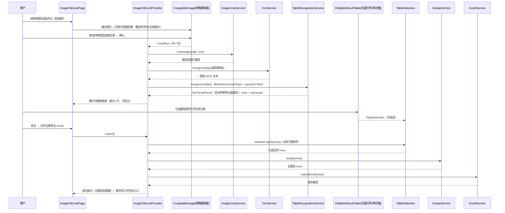
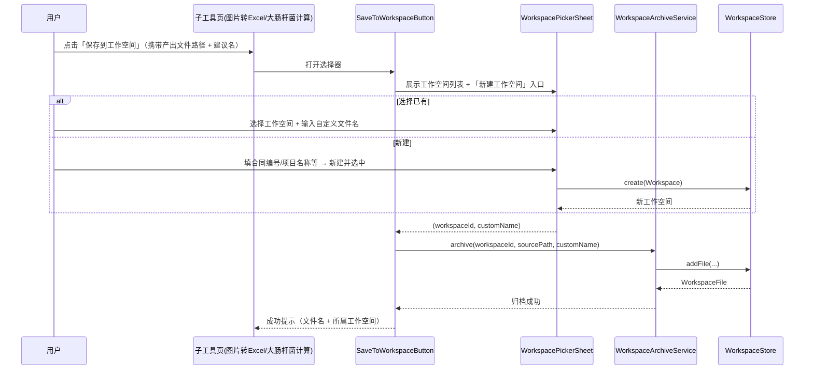
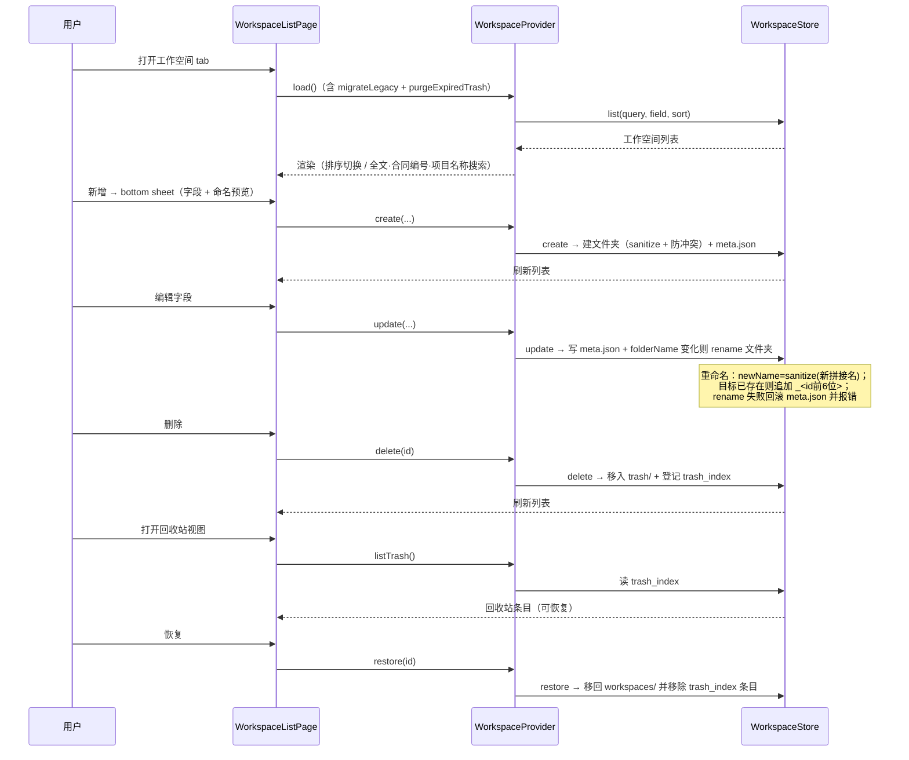

# 水质检测仪助手 — 增量架构设计 + 任务分解

> 架构师：高见远（Bob）
> 输入：`docs/PRD_increment.md`（增量 PRD）、`docs/ARCHITECTURE.md`（既有架构）、`docs/PRD.md`（全量 PRD）、`lib/` 当前代码
> 范围：仅覆盖相对第一版的 **5 条新需求 + 已澄清结论 + 需求方最终拍板**，遵循「最小变更」原则
> 配色：主色 `#1976D2`，浅蓝底 `#E3F2FD`，Android + Windows 响应式
> 状态：v1.1（已并入需求方 4 条最终拍板，见文末「本次修订」）

---

## 1. 实现方案 + 变更点（最小变更原则）

### 1.1 总体思路

1. **导航收敛**：`shell_page.dart` 从 5 目的地收敛为 3 目的地（工作空间 / 工具 / 数据传输），默认选中「工具」；「首页」就地改为「工具页」，去掉「数据传输」功能格（历史 bug），设置入口降级为工具页右上角齿轮。
2. **传输页补齐**：把已实现但埋在 `settings_page.dart` 里的传输 UI 抽到独立的 `transfer_page.dart`；`settings_page.dart` 瘦身为「OCR 配置」专属。
3. **图片转 Excel**：去掉「仪器类型选择」，改为「拍照/选图 → 四角可拖裁剪框（框选表格区域）→ 裁剪 → OCR → 表格结构自动识别（自动判断三种仪器）→ 可编辑表格 → **勾选要保留的行/列/单元格** → 去重导出 → 保存到工作空间」。
4. **大肠杆菌计算独立化**：`CalculationProvider` 拥有自己的 `imagePaths/rows`，复用共享 OCR/裁剪流程，不再依赖 `ImageToExcelProvider.rows`。
5. **工具成果归档**：新增「归档服务」，任一子工具产出文件后弹「选择/新建工作空间」并自定义文件名落盘。
6. **工作空间一等公民**：存储从 `workspaces/<id>.json`（单文件）迁移为 `workspaces/<拼接名>/`（真实文件夹：`meta.json` + 附件文件），新增回收站 `trash/`（30 天清理）与字段化命名/搜索/排序；编辑字段后**物理文件夹同步重命名**。

### 1.2 变更点清单

| 类别 | 文件 | 动作 |
| --- | --- | --- |
| 数据模型 | `lib/models/workspace.dart` | 改：新增 `contractNo/projectName/owner/item/remark/files` + `folderName`；兼容旧 JSON |
| 数据模型 | `lib/models/trash_entry.dart` | 新增 |
| 数据模型 | `lib/models/crop_rect.dart` | 新增 |
| 数据模型 | `lib/models/table_selection.dart` | 新增：勾选行/列/单元格状态 + `apply()` 过滤 |
| 数据模型 | `lib/models/fit_result.dart` | 改：新增 `toJson/fromJson`（计算归档用） |
| 存储 | `lib/services/workspace_store.dart` | 重写：文件夹式 CRUD + 迁移 + 回收站 + 30 天清理 + **重命名文件夹** |
| 服务 | `lib/services/workspace_archive_service.dart` | 新增：工具成果归档 |
| 服务 | `lib/services/image_crop_service.dart` | 新增：像素级裁剪 |
| 服务 | `lib/services/table_recognition_service.dart` | 新增：raw OCR → 仪器自动识别 → 结构化行 |
| 服务 | `lib/services/ocr_service.dart` | 改：新增 `recognizeRaw()`（拆分「识别」与「解析」） |
| 服务 | `lib/services/fit_report_service.dart` | 新增：拟合结果 **JSON + PNG + Excel**（数据表+A/B/R²+内嵌拟合图） |
| 工具 | `lib/utils/table_structure_detector.dart` | 新增：`detectInstrumentType()` |
| 工具 | `lib/utils/ocr_parser.dart` | 改：`parseOcrText` 复用（几乎不变） |
| Provider | `lib/providers/workspace_provider.dart` | 新增：工作空间 CRUD/搜索/排序/回收站状态 |
| Provider | `lib/providers/image_to_excel_provider.dart` | 改：去仪器类型、加裁剪/自动识别/**勾选**/归档 |
| Provider | `lib/providers/calculation_provider.dart` | 改：独立 rows + 拍照/导入 + 归档 |
| Provider | `lib/app.dart` | 改：注册 `WorkspaceProvider` |
| 页面 | `lib/pages/shell_page.dart` | 改：3 目的地 |
| 页面 | `lib/pages/home_page.dart` | 改：工具页（去数据传输/国标验证格 + 齿轮入口） |
| 页面 | `lib/pages/transfer_page.dart` | 新增：数据传输页（自 settings 迁出） |
| 页面 | `lib/pages/settings_page.dart` | 改：仅 OCR 配置（工具页齿轮进入） |
| 页面 | `lib/pages/image_to_excel_page.dart` | 改：去仪器类型 + 裁剪框选 + 勾选 |
| 页面 | `lib/pages/calculation_page.dart` | 改：独立拍照/导入 + 归档 |
| 页面 | `lib/pages/verification/workspace_list_page.dart` | 删除（迁至 `pages/workspace_list_page.dart`） |
| 页面 | `lib/pages/workspace_list_page.dart` | 新增（迁入增强） |
| 页面 | `lib/pages/verification/workspace_detail_page.dart` | 改：增加附件展示区（最小改动） |
| 组件 | `lib/widgets/croppable_image.dart` | 新增：四角可拖裁剪框 |
| 组件 | `lib/widgets/image_source_actions.dart` | 新增：拍照/相册/导入/粘贴 统一入口 |
| 组件 | `lib/widgets/editable_result_table.dart` | 改：增加勾选列/勾选行/单元格勾选 + 回写 |
| 组件 | `lib/widgets/workspace_create_sheet.dart` | 新增：新建 bottom sheet（字段 + 命名预览） |
| 组件 | `lib/widgets/workspace_picker_sheet.dart` | 新增：选择/新建工作空间（归档复用） |
| 组件 | `lib/widgets/save_to_workspace_button.dart` | 新增：归档按钮（封装 picker + archive） |
| 组件 | `lib/widgets/trash_view.dart` | 新增：回收站列表 |

> 数据传输服务层（`file_transfer_service.dart` / `discovery_service.dart` / `transfer_provider.dart`）与二维码协议 `WQA|1.0|{ip}:{port}|{token}` **完全复用，不改**；仅新增页面接入。

---

## 2. 完整目录 / 文件清单（相对路径）

```
lib/
├── main.dart                              # 不变
├── app.dart                               # 改：注册 WorkspaceProvider
├── core/
│   ├── constants.dart                     # 改：新增 kTrashRetentionDays=30、kWorkspaceMetaName='meta.json'
│   ├── theme.dart                         # 不变
│   └── platform.dart                      # 不变
├── models/
│   ├── instrument_type.dart               # 不变
│   ├── water_quality_row.dart             # 不变
│   ├── ocr_parse_result.dart              # 不变
│   ├── fit_result.dart                    # 改：toJson/fromJson
│   ├── peer_device.dart                   # 不变
│   ├── transfer_file.dart                 # 不变
│   ├── workspace.dart                     # 改：新字段 + WorkspaceFile + folderName
│   ├── trash_entry.dart                   # 新增
│   ├── crop_rect.dart                     # 新增
│   └── table_selection.dart               # 新增：勾选行列/单元格
├── services/
│   ├── ocr_service.dart                   # 改：recognizeRaw()
│   ├── excel_service.dart                 # 不变（数据导出）
│   ├── dedup_service.dart                 # 不变
│   ├── fit_service.dart                   # 不变
│   ├── storage_service.dart               # 不变
│   ├── file_transfer_service.dart         # 不变（复用）
│   ├── discovery_service.dart             # 不变（复用）
│   ├── qr_service.dart                    # 不变（复用）
│   ├── workspace_store.dart               # 重写：文件夹式 + 迁移 + 回收站 + 重命名
│   ├── workspace_archive_service.dart     # 新增：归档
│   ├── image_crop_service.dart            # 新增：裁剪
│   ├── table_recognition_service.dart     # 新增：raw→检测→解析
│   └── fit_report_service.dart            # 新增：JSON + PNG + Excel 报告
├── providers/
│   ├── image_to_excel_provider.dart       # 改
│   ├── calculation_provider.dart          # 改
│   ├── transfer_provider.dart             # 不变（复用）
│   └── workspace_provider.dart            # 新增
├── pages/
│   ├── shell_page.dart                    # 改：3 tab
│   ├── home_page.dart                     # 改：工具页 + 右上角齿轮进设置
│   ├── image_to_excel_page.dart           # 改
│   ├── calculation_page.dart              # 改
│   ├── settings_page.dart                 # 改：仅 OCR 配置（工具页齿轮进入）
│   ├── transfer_page.dart                 # 新增
│   ├── workspace_list_page.dart           # 新增（自 verification 迁入增强）
│   └── verification/
│       ├── workspace_detail_page.dart     # 改：附件区（最小改动）
│       ├── result_page.dart               # 不变
│       └── workspace_list_page.dart       # 删除（迁出）
├── widgets/
│   ├── responsive_navigation.dart         # 不变
│   ├── editable_result_table.dart         # 改：勾选行列/单元格 + 表头校正
│   ├── fit_chart.dart                     # 改：支持 RepaintBoundary 截图
│   ├── qr_code_card.dart                  # 不变（复用）
│   ├── file_list_tile.dart                # 不变（复用）
│   ├── status_badge.dart                  # 不变（复用）
│   ├── croppable_image.dart               # 新增
│   ├── image_source_actions.dart          # 新增
│   ├── workspace_create_sheet.dart        # 新增
│   ├── workspace_picker_sheet.dart        # 新增
│   ├── save_to_workspace_button.dart      # 新增
│   └── trash_view.dart                    # 新增
└── utils/
    ├── ocr_parser.dart                    # 改：抽取 detect 到 table_structure_detector
    ├── table_structure_detector.dart      # 新增
    ├── number_utils.dart                  # 不变
    └── result_validator.dart              # 不变
```

---

## 3. 数据模型变更

### 3.1 `Workspace` 新增字段（`models/workspace.dart`）

```dart
class Workspace {
  // ...既有 id/name/parameter/createdAt/datasets/results/overrideLimits 不变...

  /// 新增：字段化命名（bottom sheet 输入）。
  final String contractNo;   // 合同编号（必填）
  final String projectName;  // 项目名称（必填）
  final String owner;        // 项目负责人（选填）
  final String item;         // 检测项目（选填）
  final String remark;       // 其他补充（选填）

  /// 新增：归档附件（保存在工作空间文件夹内）。
  final List<WorkspaceFile> files;

  /// 拼接名（未 sanitize 的展示名）：项目名称-合同编号-项目负责人-检测项目-其他补充。
  /// 选填空字段省略该段（不占位）。
  String get displayName => Workspace.buildName(projectName, contractNo, owner, item, remark);

  /// 落盘文件夹名 = sanitize(displayName)；全部为空时回退到 name。
  String get folderName => sanitizeFolderName(displayName.isNotEmpty ? displayName : name);

  static String buildName(String projectName, String contractNo, String owner, String item, String remark) {
    return [projectName, contractNo, owner, item, remark]
        .map((s) => s.trim())
        .where((s) => s.isNotEmpty)
        .join('-');
  }

  // toJson/fromJson 新增字段，缺省值 '' / []（向后兼容旧 JSON）。
  // copyWith 扩展（含 files 与五个字段）。
}
```

> 迁移兼容：旧 JSON 无 `contractNo/projectName/.../files`，`fromJson` 用 `j['contractNo'] as String? ?? ''` 等默认值，`files` 默认 `[]`，旧工作空间仍可正常打开。

### 3.2 `WorkspaceFile`（`models/workspace.dart` 内新增）

```dart
class WorkspaceFile {
  WorkspaceFile({String? id, required this.name, required this.size, required this.kind, DateTime? createdAt})
      : id = id ?? const Uuid().v4(),
        createdAt = createdAt ?? DateTime.now();

  final String id;
  final String name;      // 自定义文件名
  final int size;         // 字节
  final String kind;      // 'excel' | 'image' | 'json' | 'pdf' | 'other'
  final DateTime createdAt;

  Map<String, dynamic> toJson() => ...;
  factory WorkspaceFile.fromJson(Map<String, dynamic> j) => ...;
}
```

### 3.3 `TrashEntry`（`models/trash_entry.dart` 新增）

```dart
class TrashEntry {
  TrashEntry({required this.id, required this.name, required this.folderName, required this.trashedAt});

  final String id;          // 原工作空间 id
  final String name;        // 显示名
  final String folderName;  // 原文件夹名（恢复时回置）
  final DateTime trashedAt;

  Map<String, dynamic> toJson() => ...;
  factory TrashEntry.fromJson(Map<String, dynamic> j) => ...;
}
```

### 3.4 `CropRect`（`models/crop_rect.dart` 新增）

```dart
/// 归一化裁剪框（相对原图，0..1），与屏幕分辨率无关。
class CropRect {
  const CropRect({required this.left, required this.top, required this.right, required this.bottom});

  final double left;    // 相对原图宽度
  final double top;     // 相对原图高度
  final double right;   // 相对原图宽度
  final double bottom;  // 相对原图高度

  bool get isValid => right > left + 0.001 && bottom > top + 0.001;
  CropRect clamp() => ...; // 约束到 [0,1] 并保证最小尺寸
}
```

### 3.5 `FitResult` 序列化（`models/fit_result.dart`）

```dart
class FitResult {
  // ...slope/intercept/rSquared/points 不变...
  Map<String, dynamic> toJson() => ...;   // 归档结果 JSON 用
  factory FitResult.fromJson(...) => ...;
}
```

### 3.6 `TableSelection`（`models/table_selection.dart` 新增）

```dart
/// 识别后勾选态（方案 B：裁剪 + 勾选行列/单元格都要）。
/// 导出/归档只保留勾选的内容。
class TableSelection {
  TableSelection({Set<String>? selectedRowIds, Set<String>? selectedColumns})
      : selectedRowIds = selectedRowIds ?? <String>{},
        selectedColumns = selectedColumns ?? <String>{};

  /// 勾选行 id（空 = 未显式选择，视为全选）。
  final Set<String> selectedRowIds;
  /// 勾选列名（空 = 未显式选择，视为全选）。
  final Set<String> selectedColumns;
  /// 单元格级勾选：rowId -> 勾选的列名集合（用于排除某行中的个别单元格）。
  final Map<String, Set<String>> excludedCells = <String, Set<String>>{};

  void toggleRow(String rowId, bool on);
  void toggleColumn(String column, bool on);
  void toggleCell(String rowId, String column, bool on);
  bool isRowSelected(String rowId) => selectedRowIds.isEmpty || selectedRowIds.contains(rowId);
  bool isColumnSelected(String column) => selectedColumns.isEmpty || selectedColumns.contains(column);

  /// 应用到行列表：过滤未勾选行，并从 cells 剔除未勾选列；列名取自 [headers]。
  List<WaterQualityRow> apply(List<WaterQualityRow> rows, List<String> headers);
}
```

### 3.7 工作空间 = 真实文件夹（存储层）

```
documents/
├── workspaces/
│   └── <拼接名>[/_<id前6位> 防冲突]/
│       ├── meta.json                     # Workspace 全量（含 files 列表）
│       ├── 水质数据_xxx.xlsx             # 附件（自定义命名）
│       ├── 拟合结果_xxx.json
│       ├── 拟合结果_xxx.png
│       └── 拟合报告_xxx.xlsx             # 数据表 + A/B/R² + 内嵌拟合图
└── trash/
    ├── trash_index.json                  # [TrashEntry...]
    └── <id>/
        └── (原工作空间文件夹整体移入，含 meta.json + 附件)
```

---

## 4. 关键接口与调用流程

### 4.1 新增 / 变更服务接口

```dart
// ---------- services/ocr_service.dart（改） ----------
abstract class OcrService {
  /// 新增：仅识别，返回拼接后的原始 OCR 文本（不解析）。
  Future<String> recognizeRaw(List<String> imagePaths);

  /// 保留：识别 + 按仪器类型解析（内部委托 recognizeRaw + parseOcrText）。
  Future<OcrParseResult> recognize(List<String> imagePaths, InstrumentType type);
  // initEngine / disposeEngine 不变
}

// ---------- utils/table_structure_detector.dart（新增） ----------
/// 依据表头特征自动判断仪器类型；无法判断返回 null。
InstrumentType? detectInstrumentType(String text);

// ---------- services/table_recognition_service.dart（新增） ----------
class TableRecognitionService {
  TableRecognitionService({required OcrService ocr});
  /// raw → 自动检测仪器类型 → 结构化行；检测失败降级为 mcgs 并附 warning。
  Future<OcrParseResult> recognizeTable(List<String> imagePaths);
}

// ---------- services/image_crop_service.dart（新增） ----------
class ImageCropService {
  /// 按归一化 CropRect 裁剪，输出新图片文件路径（纯 Dart，跨端）。
  Future<String> cropImage(String sourcePath, CropRect rect, {String? outDir});
}

// ---------- services/workspace_store.dart（重写） ----------
class WorkspaceStore {
  Future<void> migrateLegacyIfNeeded();   // 旧 <id>.json → 文件夹 + meta.json
  Future<List<Workspace>> list({String? query, SearchField field, bool newestFirst, bool includeTrashed});
  Future<Workspace?> get(String id);
  Future<Workspace> create(Workspace ws); // 建文件夹（sanitize + 防冲突）+ meta.json
  Future<void> update(Workspace ws);      // 更新 meta.json；folderName 变化则 rename 文件夹（含冲突处理）
  Future<void> delete(String id);         // 移入 trash/ + 登记 trash_index
  Future<void> restore(String id);        // 从 trash 恢复
  Future<void> purgeExpiredTrash();       // 30 天清理
  Future<WorkspaceFile> addFile(String id, String sourcePath, {String? customName}); // 拷贝附件
  Future<void> removeFile(String id, String fileId);
}

// ---------- services/workspace_archive_service.dart（新增） ----------
class WorkspaceArchiveService {
  WorkspaceArchiveService({required WorkspaceStore store});
  /// 把产出文件以自定义名归档到指定工作空间文件夹。
  Future<WorkspaceFile> archive({required String workspaceId, required String sourcePath, required String customName});
}

// ---------- services/fit_report_service.dart（新增） ----------
class FitReportService {
  FitReportService({ExcelService? excel, ExcelImageWriter? imageWriter});
  /// 生成三份产物：结果 JSON、拟合图 PNG、报告 Excel。
  /// 返回 {'json': path, 'png': path, 'xlsx': path}。
  Future<Map<String, String>> generateReport({
    required FitResult fit,
    required List<WaterQualityRow> rows,      // 参与计算的数据行
    required double concentration,
    required String unit,
    required Uint8List chartPngBytes,         // fit_chart 的 RepaintBoundary 截图
    String? outDir,
  });
}
```

**Excel 报告内容定义（`fit_report_service.dart` 生成）**：

| Sheet | 内容 |
| --- | --- |
| `拟合数据` | 数据表：表头 = `instrument.headers` + `吸光度` 列；行 = 参与计算的空白/含菌行（含勾选后的行） |
| `拟合结果` | A（截距 b）、B（斜率 a）、R²、拟合公式 `y = aX + b`、标液浓度/单位、散点 `(x,y)` 列表 |
| `拟合图` | 内嵌拟合图 PNG（`excel_community` 的 `sheet.addImage`，锚定在「拟合结果」Sheet 末尾） |

> 图片内嵌说明：当前依赖的 `excel` 原包**不支持**在单元格/Sheet 内嵌图片；拟合报告改用 `excel_community`（`excel` 的 API 兼容 fork，新增 `sheet.addImage(ExcelImage(...))`）。`excel_service.dart`（数据导出）维持 `excel` 不变，两包可共存（不同 import）。详见第 6 节。

### 4.2 时序图

#### 4.2.1 图片转 Excel：拍照 → 裁剪 → OCR → 勾选 → 表格/导出



#### 4.2.2 工具成果 → 归档到工作空间



#### 4.2.3 工作空间 CRUD + 重命名 + 回收站



---

## 5. 任务列表（有序，含依赖，按实现顺序）

> 共 **6 个任务**。T04（共享 OCR/裁剪流程）可与 T01–T03 并行；T05/T06 依赖 T02+T04。

### T01 — 工作空间存储层改造（文件夹式 + 迁移 + 重命名 + 回收站 + 归档服务）
- **依赖**：无
- **优先级**：P0
- **文件**：
  - `lib/models/workspace.dart`（改：新增 `contractNo/projectName/owner/item/remark/files` + `WorkspaceFile` + `folderName`，兼容旧 JSON）
  - `lib/models/trash_entry.dart`（新）
  - `lib/services/workspace_store.dart`（重写：`workspaces/<拼接名>/meta.json` + `trash/trash_index.json` + `migrateLegacyIfNeeded` + `purgeExpiredTrash` + `addFile/removeFile` + **重命名文件夹**）
  - `lib/services/workspace_archive_service.dart`（新）
  - `lib/core/constants.dart`（改：`kTrashRetentionDays = 30`、`kWorkspaceMetaName = 'meta.json'`）
- **要点**：
  - 迁移必须幂等（旧 `<id>.json` → 文件夹后删除旧文件）。
  - 文件夹名 `sanitize`：去掉 `\/:*?"<>|`、去首尾空格与点；选填空字段**省略该段**（不占位）。
  - 同名冲突自动追加 `_<id前6位>`。
  - **重命名落盘**：`update()` 时对比新旧 `folderName`；变化则 `Directory.rename(newName)`，目标已存在则先追加 `_<id前6位>`；rename 失败回滚 `meta.json` 并抛错，不残留半写状态。
  - `purgeExpiredTrash` 在 `list()` 前自动调用。

### T02 — 工作空间页重构（列表 + 搜索排序 + 新建/选择 sheet + 回收站视图）
- **依赖**：T01
- **优先级**：P0
- **文件**：
  - `lib/providers/workspace_provider.dart`（新）
  - `lib/pages/workspace_list_page.dart`（新，迁自 `pages/verification/workspace_list_page.dart` 并增强）
  - `lib/widgets/workspace_create_sheet.dart`（新：必填合同编号+项目名称，选填负责人/检测项目/补充，实时命名预览）
  - `lib/widgets/workspace_picker_sheet.dart`（新：选择/新建工作空间，供归档复用）
  - `lib/widgets/save_to_workspace_button.dart`（新：封装 picker + archive 的归档按钮）
  - `lib/widgets/trash_view.dart`（新：回收站列表 + 恢复）
  - `lib/pages/verification/workspace_list_page.dart`（删）
- **要点**：排序「创建时间正/逆」；搜索默认全文模糊，可切换「合同编号 / 项目名称」；列表卡片展示拼接名 + 字段摘要 + 附件数 + 创建时间；编辑入口复用 `workspace_create_sheet`（编辑态），保存后触发 `WorkspaceStore.update`（含重命名）。

### T03 — 导航 3 tab + 工具页 + 数据传输正式页面 + 设置页（齿轮入口）
- **依赖**：T02
- **优先级**：P0
- **文件**：
  - `lib/pages/shell_page.dart`（改：3 目的地「工作空间/工具/数据传输」，默认 index=1）
  - `lib/pages/home_page.dart`（改：工具页——去「数据传输」「国标验证」功能格，保留图片转Excel/大肠杆菌计算，新增国标验证入口 + **AppBar 右上角齿轮进设置**）
  - `lib/pages/transfer_page.dart`（新：自 `settings_page.dart` 迁出传输 UI，复用 `TransferProvider` + `qr_code_card`/`file_list_tile`/`status_badge`）
  - `lib/pages/settings_page.dart`（改：仅 OCR 配置，AppBar 标题「设置」，由工具页齿轮 `Navigator.push` 进入，非独立 tab）
  - `lib/app.dart`（改：注册 `WorkspaceProvider`）
- **要点**：修复「服务层有、页面无」历史 bug；`home_page.dart` 不再有「数据传输」格（数据传输归右 tab）；设置 = 工具页右上角齿轮（**不是独立 tab、不并入传输页**）。

### T04 — 共享 OCR/裁剪/表格识别/勾选流程（供两工具复用）
- **依赖**：无（可与 T01–T03 并行）
- **优先级**：P0
- **文件**：
  - `lib/models/crop_rect.dart`（新：归一化裁剪框 + clamp）
  - `lib/models/table_selection.dart`（新：勾选行列/单元格 + `apply()` 过滤）
  - `lib/services/image_crop_service.dart`（新：`package:image` 像素裁剪，跨端）
  - `lib/services/ocr_service.dart`（改：新增 `recognizeRaw()`，`CloudOcrService`/`LocalPythonOcrService` 各自实现；`recognize()` 委托）
  - `lib/utils/table_structure_detector.dart`（新：`detectInstrumentType()`，按「吸光度+数据标识→总铜」「通道→E.co」「空白对照/测试对照→MCGS」优先级）
  - `lib/utils/ocr_parser.dart`（改：`parseOcrText` 保持，抽取检测逻辑）
  - `lib/services/table_recognition_service.dart`（新：raw → 检测 → 解析）
  - `lib/widgets/croppable_image.dart`（新：`Stack` + `Positioned` + 四角 `GestureDetector` + `CustomPainter` 遮罩，跨 Android/Windows）
  - `lib/widgets/image_source_actions.dart`（新：拍照/相册/导入/粘贴 统一入口条）
- **要点**：裁剪框手写（不引 `image_cropper`，其仅移动端）；`recognizeRaw` 拆分使「自动检测仪器类型」成为可能；检测失败降级 `mcgs` 并 warning 提示人工确认；`TableSelection` 空集合=全选语义，`apply()` 供导出/归档复用。

### T05 — 图片转 Excel 改造（去仪器类型 + 裁剪 + 勾选 + 归档）
- **依赖**：T02、T04
- **优先级**：P0
- **文件**：
  - `lib/providers/image_to_excel_provider.dart`（改：移除 `instrument` 选择状态与 `setInstrument`，新增 `cropRect`/`croppedPaths`/`selection`/`recognize()` 走 `TableRecognitionService`，`export()` 前先 `selection.apply(rows)`，新增 `saveToWorkspace()`）
  - `lib/pages/image_to_excel_page.dart`（改：删除 `SegmentedButton` 仪器选择；接入 `ImageSourceActions` + `CroppableImage` 裁剪流程；`EditableResultTable` 增加勾选；底部「保存到工作空间」用 `SaveToWorkspaceButton`）
  - `lib/widgets/editable_result_table.dart`（改：表头由自动检测的 instrument.headers 驱动，增加行勾选列/列头勾选/单元格勾选，`onSelectionChanged` 回写 `TableSelection`）
- **要点**：拍照后先裁剪（提示「框选到表格」），裁剪图再 OCR，识别后再勾选行/列/单元格；导出只含勾选内容；桌面端仍支持 file_picker/粘贴/拖拽；仪器类型由结构自动识别。

### T06 — 大肠杆菌计算独立化 + 计算成果归档（JSON + PNG + Excel）
- **依赖**：T02、T04
- **优先级**：P0
- **文件**：
  - `lib/providers/calculation_provider.dart`（改：拥有独立 `imagePaths/rows`，新增 `addImages/recognize/import`，复用 `TableRecognitionService`；不再读 `ImageToExcelProvider.rows`；新增归档三件套）
  - `lib/pages/calculation_page.dart`（改：顶部 `ImageSourceActions` 拍照/导入，去掉「请先在图片转Excel页识别」提示；底部 `SaveToWorkspaceButton`）
  - `lib/models/fit_result.dart`（改：`toJson/fromJson`）
  - `lib/services/fit_report_service.dart`（新：生成 JSON + PNG + Excel；Excel 内嵌拟合图用 `excel_community`）
  - `lib/widgets/fit_chart.dart`（改：包 `RepaintBoundary` 支持截图导出 PNG）
- **要点**：计算逻辑（吸光度 `ln(空白/检测)*10000`、空白<检测 反向、拟合 `y=aX+b` 输出 a=B/b=A/R²、总铜不参与拟合）保持不变；归档产出 = **结果 JSON + 拟合图 PNG + 报告 Excel（数据表 + A/B/R² + 内嵌拟合图）** 三个文件（自定义名，三者同名不同后缀）。

> **依赖图**：`T01 → T02 → T03`；`T04` 独立；`T05/T06 ← T02 + T04`。T05、T06 可并行。

---

## 6. 依赖包清单（新增 + 双端可用性评估）

### 6.1 新增依赖

```yaml
dependencies:
  # 纯 Dart 图像裁剪/编码（跨 Android/Windows，无原生依赖、无许可风险）
  image: ^4.2.0

  # 拟合报告内嵌图片：excel 的 API 兼容 fork（sheet.addImage 内嵌 PNG）
  # 仅 fit_report_service.dart 使用；数据导出仍用 excel，两包共存（不同 import）
  excel_community: ^2.5.0
```

> 其余能力全部沿用既有依赖：`provider` / `file_picker` / `image_picker` / `excel` / `fl_chart` / `mobile_scanner` / `qr_flutter` / `shared_preferences` / `path` / `path_provider` / `uuid` / `http`。传输、UDP、本机 IP 继续用 `dart:io`。
>
> **拟合图内嵌的包选择**（`excel` 原包不支持内嵌图片）：
> - 首选 `excel_community`（`excel` fork，API 兼容 + `sheet.addImage(ExcelImage(...))`）。
> - 备选 `excel_plus`（`excel` 的 source-compatible 替代，`sheet.insertImage`）。
> - 兜底（不引新包）：Excel 仅含数据表 + A/B/R² 文本，拟合图独立 PNG 并列归档。

### 6.2 `camera` / `image_cropper` 评估结论

| 包 | 双端可用性 | 结论 |
| --- | --- | --- |
| `camera` | **仅 Android/iOS**，Windows 无实现（引入后桌面端编译失败，需条件导入） | **P0 不引入**。用 `image_picker` 系统相机拍照，再把「参考线/边缘提示」放到拍照后的 `CroppableImage` 裁剪预览上（低成本、跨端一致）。P1-2 若需实时取景引导，再按下方条件导入方案引入，仅 Android 生效。 |
| `image_cropper` | **仅 Android/iOS**，Windows 不支持 | **不引入**。手写 `CroppableImage`（四角可拖，`CustomPainter` 遮罩），约 150–250 行，跨端一致、零维护风险。 |
| `crop_your_image` | 纯 Dart 但功能/维护需确认，且交互超出需求 | **不引入**，需求只需四角可拖长方形裁剪。 |

### 6.3 平台隔离方案（P1 若引入 `camera`）

```dart
// lib/services/capture/camera_capture.dart
import 'camera_capture_stub.dart'
    if (dart.library.io) 'camera_capture_io.dart';

abstract class CameraCapture {
  Future<void> openPreview();   // io 实现：camera 插件实时预览 + 参考线
}

// lib/services/capture/camera_capture_stub.dart   （桌面端 no-op，返回 Unsupported）
// lib/services/capture/camera_capture_io.dart     （仅 Android，import package:camera/camera.dart）
```

调用侧用 `if (isMobile)` 守卫；桌面端走 `file_picker`/粘贴/拖拽（`ImageSourceActions` 内部按平台分流）。

---

## 7. 共享知识约定（增量追加）

- **命名沿用**：文件 `snake_case`、类 `PascalCase`、成员 `camelCase`、常量 `SCREAMING_SNAKE_CASE + k`。
- **状态管理**：沿用 `provider` + `ChangeNotifier`；新增 `WorkspaceProvider` 统一承载工作空间 CRUD/搜索/排序/回收站；禁止 widget 直调 service。
- **工作空间存储**：一律经 `WorkspaceStore`；文件夹名 = `sanitize(拼接名)`，冲突追加 `_<id前6位>`；`meta.json` 为唯一元数据源；附件为文件夹内其余文件。
- **拼接名**：`项目名称-合同编号-项目负责人-检测项目-其他补充`；选填空字段**省略该段**（不占位）；编辑字段后 `update()` 同步重命名物理文件夹。
- **重命名落盘**：`update()` 对比新旧 `folderName`；变化则 `Directory.rename`，目标已存在先追加 `_<id前6位>`；失败回滚 `meta.json` 并抛错。
- **回收站**：删除 = 移动文件夹到 `trash/<id>/` + 写 `trash_index.json`；`purgeExpiredTrash()` 每次 `list()` 前执行（30 天）；恢复 = 移回 `workspaces/<folderName>/`。
- **旧数据迁移**：`WorkspaceStore.migrateLegacyIfNeeded()` 幂等，首轮识别 `workspaces/*.json`（非 `meta.json`）并转文件夹；迁移后删除旧文件。
- **OCR 接口约定**：`recognizeRaw` 只返回文本；`parseOcrText` 只做解析；仪器类型由 `detectInstrumentType` 自动判定（优先级：总铜 > E.co > MCGS），检测失败降级 `mcgs` 并 warning。
- **裁剪约定**：`CropRect` 一律归一化（0..1），组件负责屏幕坐标 ↔ 归一化互转；裁剪输出 PNG 到临时目录后交给 OCR。
- **勾选约定**：`TableSelection` 空集合 = 全选；导出/归档统一走 `selection.apply(rows)` 后再去重/生成。
- **归档约定**：所有「保存到工作空间」走 `WorkspaceArchiveService.archive(workspaceId, sourcePath, customName)`；自定义名去非法字符；冲突策略 MVP = 覆盖提示（P2-1 再做重命名策略）。
- **计算归档三件套**：JSON（A/B/R²/散点）+ PNG（拟合图截图）+ Excel（数据表 + A/B/R² + 内嵌拟合图），三者同名不同后缀。
- **平台守卫**：OCR 相关用 `isAndroid/isDesktop` 分流；裁剪为纯 Dart 跨端；拍照引导 P0 用系统相机（`image_picker`）。
- **错误处理**：服务层可预期失败返回 `null`/空列表 + warning，不抛裸异常；Provider 暴露 `error` 字符串，UI 用 `SnackBar`/`_Banner` 展示。

---

## 8. 已拍板决策 + 剩余默认值

### 8.1 需求方已拍板（本次并入）

1. **「框选」= 裁剪 + 勾选行列/单元格都要（方案 B）**：拍照/选图后先四角裁剪（`CroppableImage`）→ OCR 出表格 → `EditableResultTable` 内勾选行/列/单元格（`TableSelection`）→ 导出/归档只保留勾选内容。
2. **设置页 = 工具页右上角齿轮入口**：非独立 tab、不并入传输页；`settings_page.dart` 仅 OCR 配置，由工具页 AppBar 齿轮 `Navigator.push` 进入。
3. **拼接命名**：选填字段为空**省略该段**（不占位）；**编辑工作空间信息后物理文件夹同步重命名**（`WorkspaceStore.update` 内 rename，含同名冲突 + 非法字符清洗，见 T01/T02）。
4. **大肠杆菌计算归档 = JSON + PNG + Excel 三者**：`fit_report_service` 生成三件套，Excel 内容 = 数据表 + A/B/R² + 内嵌拟合图（`excel_community` 的 `sheet.addImage`）。

### 8.2 其余事项（维持文档建议默认值，不再追问）

- **拍照引导 P1 实时取景**：本次不做（P0 用系统相机 + 裁剪预览参考线）；P1 若做按 6.3 条件导入 `camera`。
- **国标验证与工作空间双入口**：工作空间 tab 点击条目 → `WorkspaceDetailPage`；工具页「国标验证」→ `WorkspacePickerSheet` 选择/新建 → `WorkspaceDetailPage`。
- **旧数据空字段展示**：迁移后 `contractNo/projectName` 为空、`name` 保留旧名，列表按 `name` 展示。
- **归档同名冲突**：MVP = 覆盖提示。
- **回收站粒度**：删除时连同附件整体移入 `trash/<id>/`，恢复整体移回。

---

## 9. 本次修订说明（相对 v1.0）

| 章节 | 改动 |
| --- | --- |
| 1.1 / 1.2 | 图片转Excel 流程补「勾选行/列/单元格」；变更点新增 `table_selection.dart` 与 `editable_result_table` 勾选；`fit_report_service` 改为三件套 |
| 2 | 目录新增 `models/table_selection.dart`；`fit_report_service` 注释改「JSON+PNG+Excel」；`editable_result_table` 改「勾选行列/单元格」 |
| 3 | 新增 3.6 `TableSelection`；3.7 存储布局补拟合三件套文件 |
| 4 | 4.1 新增 `TableSelection` 语义、`fit_report_service.generateReport` 三件套 + Excel 报告内容定义；4.2.1 时序图补勾选步骤；4.2.3 补重命名落盘 note |
| 5 | T01 补「重命名文件夹」落盘/冲突；T03 明确设置=齿轮入口；T04 新增 `table_selection.dart`；T05 补勾选 + 导出前 `selection.apply`；T06 改为 JSON+PNG+Excel 三件套 + `excel_community` |
| 6 | 新增 `excel_community`（拟合图内嵌）；补包选择（首选/备选/兜底） |
| 7 | 共享知识补：拼接名省略空段、重命名落盘、勾选约定、计算归档三件套 |
| 8 | 拆为「已拍板决策」+「剩余默认值」，移除已确认条目 |

---

*本文档为增量架构与任务分解基线（v1.1），供工程师（Engineer）按 T01→T06 实现；实现中若发现接口不匹配，按「共享知识」约定回写修订。*
