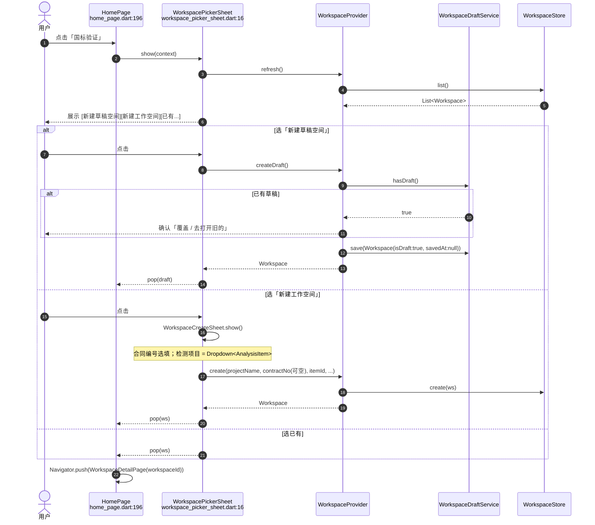
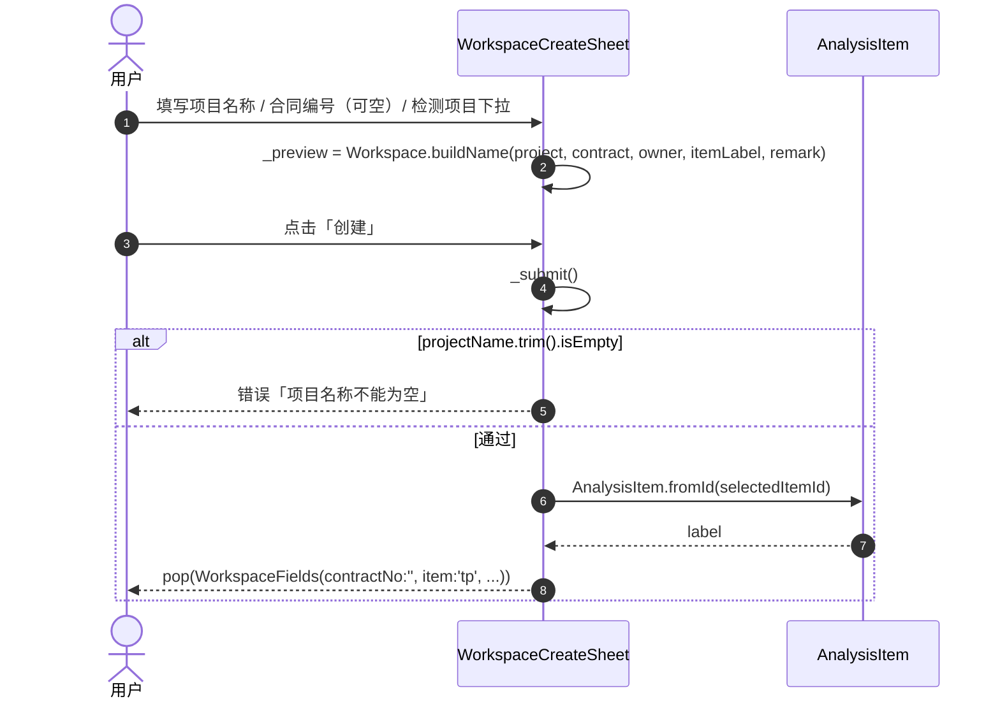
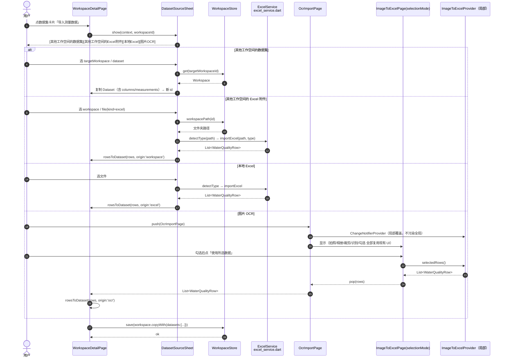
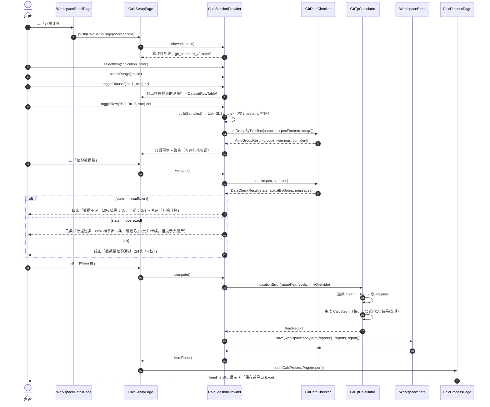
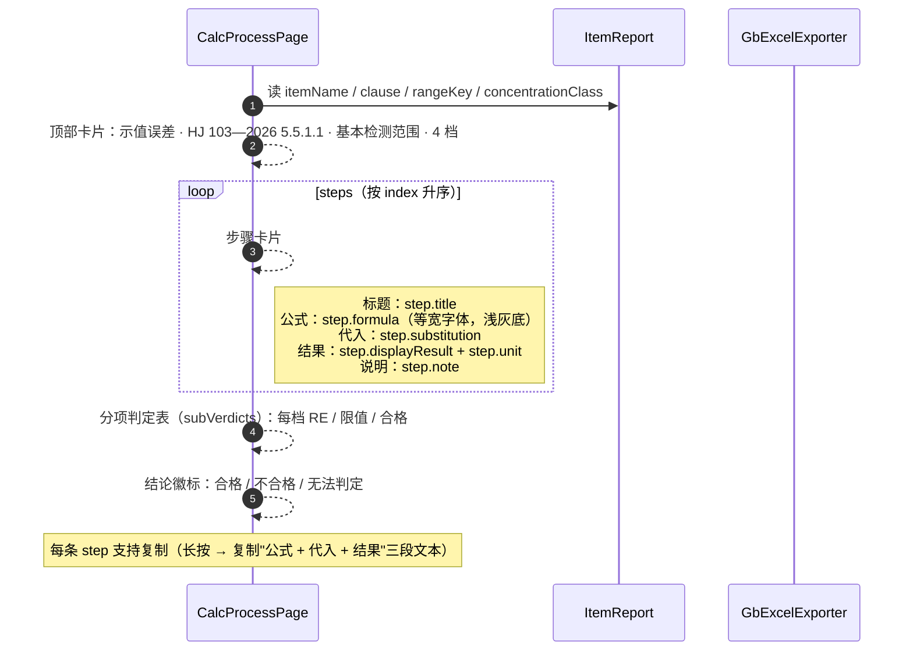
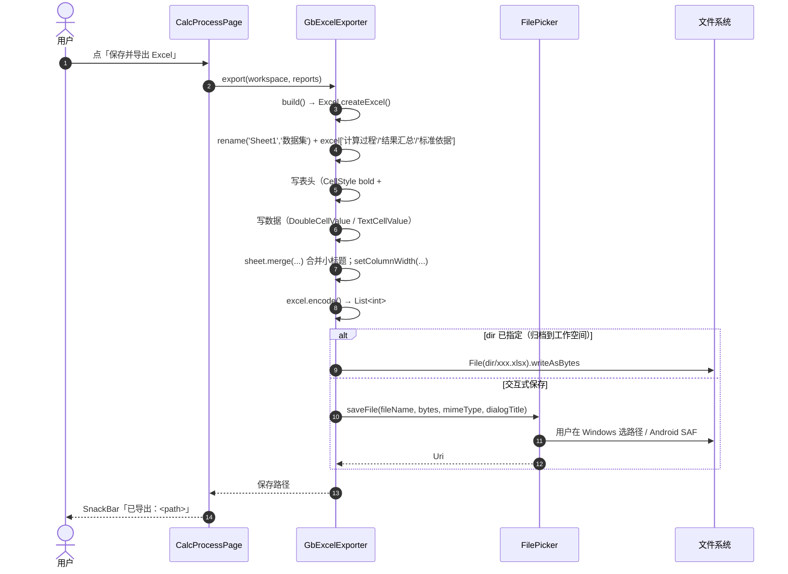
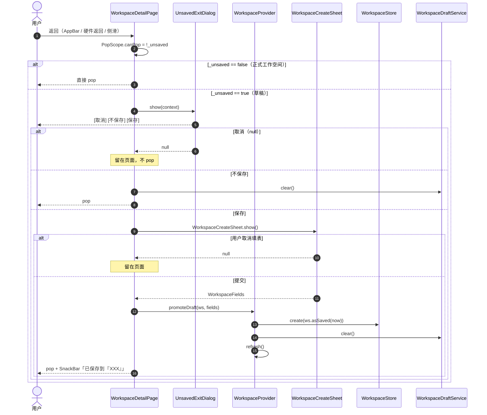
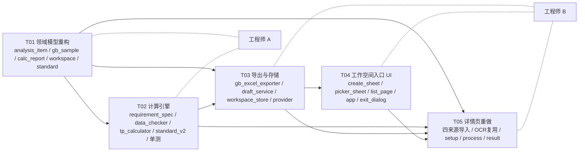

# 国标验证（总磷 HJ 103—2026）重做版 · 架构设计 + 任务分解

> 版本：v2（重做版） · 作者：Architect（Bob） · 目标读者：实施工程师 A / B
>
> **唯一计算依据**：`docs/GB_HJ103_TP_SPEC.md`（HJ 103—2026 原文逐条整理）。
> 本文件与它冲突时，以 `GB_HJ103_TP_SPEC.md` 为准，并回头修正本文件。
>
> **本文件不修改任何 `.dart` 代码**，只描述「照着写就能写出来」的设计。

---

# Part A · 系统设计

## 1. 实施路径与关键技术选择

### 1.1 需求难点拆解

| 难点 | 本质问题 | 设计对策 |
|---|---|---|
| 「草稿空间」存在但可不存在 | 领域上多了一种"尚未成为工作空间"的生命周期状态 | 独立单例草稿文件 `documents/draft/draft.json`，不进 `workspaces/`，不出现在列表；`Workspace.isDraft` + `savedAt` 双字段表达 |
| 合同编号可空、检测项目变下拉 | 现有表单与 `WorkspaceProvider.create` 都硬校验合同编号 | 校验下沉为「仅项目名称必填」；`item` 改存 id（`cod/tn/tp/nh3n`），中文名由 `AnalysisItem` 映射；`displayName` 用中文 label 拼接，文件夹名仍是中文 |
| 数据来源有 3 种（手输 / Excel / 其他工作空间 / OCR 图片） | 现有 `Measurement` 只有 `values:{'value':x}`，承载不了「吸光度 / 数据标识 / 空白值」等列 | `Measurement` 增 `raw: Map<String,String>`（原始列文本）+ `valid: bool`；`Dataset` 增 `columns`（列元数据）+ `origin`（溯源）；**旧 JSON 全字段缺省可解析** |
| 复用「图片转 Excel」页面并回传结果 | 该页依赖**全局单例** `ImageToExcelProvider`（`lib/app.dart:31`），直接 push 会污染首页状态 | 给 `ImageToExcelPage` 加 `selectionMode` 开关 + **局部 `ChangeNotifierProvider` 覆盖**，`Navigator.pop(context, rows)` 回传 |
| 「可只算某些行」+「过少/过多提示」+「逐步公式」 | 计算引擎从"返回一个 double"升级为"返回可审计报告" | 新建 `GbTpCalculator`：纯函数、每项一个入口、返回 `ItemReport`（内含有序 `CalcStep` 列表）；另有独立 `GbDataChecker` 做三态校验 |
| 浓度分类（10%/20%/50%/80%、0.4 分界） | 标准用"上限值百分比"定义溶液浓度，而 OCR 只给数值和时间 | 三级分类器：`classifyRange` / `classifyLevel`（±3% 容差）/ `classifyCompare`；**分组靠"按时间顺序切片 + 实测值校验"，可人工覆盖**（见 §3.5.3） |
| 导出 Excel 含「数据集 + 计算过程 + 结果」 | 现有 `ExcelService.exportExcel` 只写一张宽表 | 新建 `GbExcelExporter`，4 个 Sheet，复用 `excel: ^4.0.6` 的 `Excel.createExcel / sheet.merge / setColumnWidth / CellStyle` |

### 1.2 框架与库选择（不新增任何依赖）

| 用途 | 选择 | 理由 |
|---|---|---|
| 状态管理 | `provider: ^6.1.5+1`（已有） | 全应用一致；新增 `CalcSessionProvider` 注册进 `lib/app.dart` 的 `MultiProvider` |
| Excel 读写 | `excel: ^4.0.6`（已有，`pubspec.lock` 已锁 4.0.6） | 已确认 API：`Excel.createExcel()`、`excel['新表名']` 会自动建表（`excel-4.0.6/lib/src/excel.dart:100` 的 `operator[]` 内部调用 `_availSheet`）、`Sheet.merge(start,end)`（`sheet.dart:741`）、`Sheet.setColumnWidth(int,double)`（`sheet.dart:1209`）、`CellStyle(bold/backgroundColorHex/horizontalAlign...)`（`cell_style.dart:26`）、`ExcelColor.fromHexString`（`utilities/colors.dart:111`） |
| 文件选择 / 保存 | `file_picker: ^13.3.1`（已有） | Windows 用 `FilePicker.saveFile(bytes:)`，与 `excel_service.dart:153` 一致 |
| 目录 | `path_provider: ^2.1.6`（已有） | Android 无对话框时回退文档目录 |
| ID | `uuid: ^4.6.0`（已有） | 与现有模型一致 |
| 退出拦截 | Flutter `PopScope` | 项目已在 `lib/widgets/crop_page.dart:69` 使用 `PopScope(canPop:false)`，说明 SDK 支持 `onPopInvokedWithResult` |

### 1.3 架构模式

- **分层**：`models`（纯数据，手写 `toJson/fromJson`）→ `services`（纯计算 / 文件 IO / 导出）→ `providers`（状态编排）→ `pages/widgets`（UI）。
- **计算层零 Flutter 依赖**：`gb_tp_calculator.dart` / `gb_data_checker.dart` 只用 `dart:math`，可在 `flutter test` 里纯单测（现有 `test/` 目录已具备条件）。
- **单向数据流**：Page → Provider → Service → Provider.notifyListeners → Page 重建。禁止 Widget 直接调计算服务（与 `lib/providers/workspace_provider.dart:9` 注释的约定一致）。

---

## 2. 文件清单

### 2.1 新增文件

| # | 路径 | 职责一句话 | 归属 |
|---|---|---|---|
| N1 | `lib/core/analysis_item.dart` | 检测项目枚举 `AnalysisItem`（cod/tn/tp/nh3n）+ id↔中文名双向映射 + 容错解析（兼容历史自由文本） | A |
| N2 | `lib/models/gb_sample.dart` | 计算输入纯模型：`GbSample` / `GbLevelSamples` / `GbSpecimen` / `GbConsistencySlot` / `RangeProfile` / `ConcentrationLevel` / `CompareMode` | A |
| N3 | `lib/models/calc_report.dart` | 计算产物模型：`CalcStep` / `SubVerdict` / `ItemReport` / `CalcSession` / `CalcInput` | A |
| N4 | `lib/services/gb_requirement_spec.dart` | 13 个验证项的「数据量要求」声明表 + `RequirementSpec` / `GroupRequirement` / `SpecFor` 查询 | A |
| N5 | `lib/services/gb_data_checker.dart` | 数据量校验器（三态）+ 时间线自动分组 `autoGroupByTimeline` | A |
| N6 | `lib/services/gb_tp_calculator.dart` | 13 项计算入口（纯函数），每项返回 `ItemReport` 内含有序 `CalcStep` | A |
| N7 | `lib/services/gb_standard_v2.dart` | HJ 103—2026 修正后的 `Standard` 定义（替代 `standard_definitions.dart` 里错的总磷限值） | A |
| N8 | `lib/services/gb_excel_exporter.dart` | 四 Sheet 导出（数据集/计算过程/结果汇总/标准依据）+ 保存路径策略 | A |
| N9 | `lib/services/workspace_draft_service.dart` | 单例草稿：`load/save/clear/has`，落 `documents/draft/draft.json` | B |
| N10 | `lib/providers/calc_session_provider.dart` | 计算会话状态：选数据集 / 选行 / 选验证项 / 选量程 / 分组 / 校验 / 执行计算 | B |
| N11 | `lib/pages/verification/dataset_source_sheet.dart` | 「导入测量数据」来源选择：其他工作空间已解析数据集 / 其他工作空间 Excel 附件 / 本地 Excel 文件 | B |
| N12 | `lib/pages/verification/ocr_import_page.dart` | OCR 导入页：局部 Provider 包 `ImageToExcelPage(selectionMode:true)`，回传 `List<WaterQualityRow>` | B |
| N13 | `lib/pages/verification/calc_setup_page.dart` | 计算设置页：选验证项/量程/数据集/行 → 分组 → 校验 → 计算 | B |
| N14 | `lib/pages/verification/calc_process_page.dart` | 计算过程页：Timeline 逐步展示公式/代入/结果/说明 → 导出 | B |
| N15 | `lib/widgets/dataset_row_table.dart` | 可勾选的测量行表格（含分组下拉、时间、数值、原始行） | B |
| N16 | `lib/widgets/unsaved_exit_dialog.dart` | 「当前工作空间还没保存」三按钮对话框（保存/不保存/取消） | B |
| N17 | `test/gb_tp_calculator_test.dart` | 13 项计算 + 3 个分类器 + 数据量校验的单测 | A |

### 2.2 修改文件

| # | 路径 | 改动要点 | 归属（唯一负责人） |
|---|---|---|---|
| M1 | `lib/models/workspace.dart` | `Measurement` 增 `raw`/`valid`；`Dataset` 增 `columns`/`origin`；`Workspace` 增 `isDraft`/`savedAt`/`status`/`reports`/`limitsVersion`；`item` 语义改 id；`buildName` 用 `itemLabel` | **A** |
| M2 | `lib/models/standard.dart` | `StandardItemLimit` 增 `note`（缺省 `''`，兼容）；`VerificationItem` 增 `clause`（条款号，缺省 `''`） | **A** |
| M3 | `lib/services/standard_definitions.dart` | 总磷 13 项限值/算法口径更正 + 新增 `sample_compare`；`selectableParameters` 改为 `AnalysisItem` 派生 | **A** |
| M4 | `lib/services/workspace_store.dart` | 增 `findByFolderName`、`duplicateDatasetFrom`（跨工作空间复制数据集用）；`migrateLegacyIfNeeded` 补 `limitsVersion` 迁移 | **B** |
| M5 | `lib/providers/workspace_provider.dart` | `create` 去掉合同编号必填校验、`item` 改 id、增 `createDraft/saveDraft/promoteDraft/discardDraft` | **B** |
| M6 | `lib/widgets/workspace_create_sheet.dart` | 合同编号改选填（去 `*`）；检测项目改 `DropdownButtonFormField<AnalysisItem>`；`WorkspaceFields.item` 改存 id | **B** |
| M7 | `lib/pages/workspace_list_page.dart` | 新建入口增加「从草稿继续」；卡片展示 `status` 徽标；`_create()` 传 `item: fields.item`（id） | **B** |
| M8 | `lib/pages/verification/workspace_detail_page.dart` | **重写**：数据集列 → 导入/OCR/删除；计算入口跳 `CalcSetupPage`；`PopScope` 退出拦截 | **B** |
| M9 | `lib/pages/verification/result_page.dart` | 改为读 `Workspace.reports`（`ItemReport`），兼容旧 `CalcResult` 只读提示 | **B** |
| M10 | `lib/pages/image_to_excel_page.dart` | 加 `selectionMode` 参数；`selectionMode` 下底部出「使用所选数据」按钮并 `pop(rows)` | **B** |
| M11 | `lib/providers/image_to_excel_provider.dart` | 增 `reset()`（清 rows/selection/图片/warnings）供 `selectionMode` 退出时调用 | **B** |
| M12 | `lib/app.dart` | 注册 `ChangeNotifierProvider<CalcSessionProvider>` | **B** |
| M13 | `lib/utils/workspace_utils.dart` | `guessStandardParameter` 改为调用 `AnalysisItem.fromAny` 的薄封装 | **B** |

### 2.3 文件冲突纪律（并行硬约束）

- **A 独占（B 只读不改）**：`lib/models/workspace.dart`、`lib/models/standard.dart`、`lib/models/gb_sample.dart`、`lib/models/calc_report.dart`、`lib/core/analysis_item.dart`、`lib/services/gb_*.dart`、`lib/services/standard_definitions.dart`、`test/gb_tp_calculator_test.dart`。
- **B 独占（A 只读不改）**：`lib/services/workspace_store.dart`、`lib/services/workspace_draft_service.dart`、`lib/providers/*.dart`、`lib/pages/**`、`lib/widgets/**`、`lib/app.dart`、`lib/utils/workspace_utils.dart`。
- **A 先落地 M1/M2/N2/N3/N1 四个模型文件并 `dart analyze` 通过后，B 才动 M5/M8**（B 依赖新字段签名）。

---

## 3. 数据结构与接口

### 3.1 类图

```mermaid
classDiagram
  direction LR

  class AnalysisItem {
    <<enumeration>>
    cod
    tn
    tp
    nh3n
    +String id
    +String label
    +Standard? standard
    +static AnalysisItem? fromId(String)
    +static AnalysisItem? fromLabel(String)
    +static AnalysisItem fromAny(String)
  }

  class Measurement {
    +String id
    +String? label
    +DateTime? timestamp
    +Map~String,double~ values
    +Map~String,String~ raw
    +bool valid
    +String rawText
    +double? get result
    +toJson() Map
    +fromJson(Map)$ Measurement
  }

  class ColumnMeta {
    +String key
    +String label
    +String unit
    +bool numeric
    +bool usedInCalc
    +toJson() Map
    +fromJson(Map)$ ColumnMeta
  }

  class Dataset {
    +String id
    +String name
    +String parameter
    +DateTime createdAt
    +List~Measurement~ measurements
    +List~ColumnMeta~ columns
    +String origin
    +String? originName
    +toJson() Map
    +fromJson(Map)$ Dataset
  }

  class Workspace {
    +String id
    +String name
    +String parameter
    +String item
    +String contractNo
    +String projectName
    +String owner
    +String remark
    +bool isDraft
    +DateTime? savedAt
    +String status
    +int limitsVersion
    +DateTime createdAt
    +List~Dataset~ datasets
    +List~CalcResult~ results
    +List~ItemReport~ reports
    +Map overrideLimits
    +List~WorkspaceFile~ files
    +String get itemLabel
    +String get displayName
    +String get folderName
    +StandardItemLimit? effectiveLimit(VerificationItem, String)
    +copyWith() Workspace
    +toJson() Map
    +fromJson(Map)$ Workspace
  }

  class RangeProfile {
    +String key
    +String label
    +double lower
    +double upper
    +basic$ RangeProfile
    +extended$ RangeProfile
  }

  class ConcentrationLevel {
    +String id
    +double percent
    +double nominal
    +RangeProfile range
  }

  class GbSample {
    +String measurementId
    +String datasetId
    +double value
    +DateTime? timestamp
    +String group
    +String specimenNo
    +double? labMean
  }

  class GbLevelSamples {
    +String levelId
    +double nominal
    +List~GbSample~ samples
  }

  class GbSpecimen {
    +String no
    +double labMean
    +List~GbSample~ samples
    +CompareMode mode
  }

  class GbConsistencySlot {
    +int index
    +List~double~ instrumentValues
  }

  class CalcStep {
    +int index
    +String title
    +String formula
    +String substitution
    +double rawResult
    +String displayResult
    +String unit
    +String note
    +toJson() Map
    +fromJson(Map)$ CalcStep
  }

  class SubVerdict {
    +String key
    +String label
    +double rawValue
    +String displayValue
    +String unit
    +double limit
    +bool pass
    +toJson() Map
    +fromJson(Map)$ SubVerdict
  }

  class ItemReport {
    +String id
    +String itemId
    +String itemName
    +String clause
    +String rangeKey
    +String concentrationClass
    +double? metricValue
    +String metricUnit
    +double? limitValue
    +bool? pass
    +String? failReason
    +int sampleCount
    +List~CalcStep~ steps
    +List~SubVerdict~ subVerdicts
    +DateTime createdAt
    +toJson() Map
    +fromJson(Map)$ ItemReport
  }

  class CalcSession {
    +String id
    +String workspaceId
    +String itemId
    +String rangeKey
    +List~CalcInput~ inputs
    +DateTime createdAt
    +toJson() Map
    +fromJson(Map)$ CalcSession
  }

  class CalcInput {
    +String datasetId
    +String measurementId
    +double value
    +DateTime? timestamp
    +String group
    +String specimenNo
    +toJson() Map
    +fromJson(Map)$ CalcInput
  }

  class RequirementSpec {
    +String itemId
    +String clause
    +bool requiresManualGrouping
    +List~GroupRequirement~ groups
  }

  class GroupRequirement {
    +String key
    +String label
    +double? nominal
    +int min
    +int exact
    +int? max
  }

  class DataCheckResult {
    +DataCheck state
    +Map~String,int~ actualByGroup
    +List~String~ messages
  }

  class GbTpCalculator {
    +classifyRange(double)$ RangeProfile
    +upperLimitOf(String)$ double
    +classifyLevel(double, double, double)$ ConcentrationLevel?
    +classifyCompare(double)$ CompareMode
    +indicationError(...)$ ItemReport
    +loq(...)$ ItemReport
    +repeatability(...)$ ItemReport
    +driftLow24h(...)$ ItemReport
    +driftHigh24h(...)$ ItemReport
    +memoryEffect(...)$ ItemReport
    +voltageEffect(...)$ ItemReport
    +turbidityEffect(...)$ ItemReport
    +temperatureEffect(...)$ ItemReport
    +sampleComparison(...)$ ItemReport
    +maintenanceCycle(...)$ ItemReport
    +dataAvailability(...)$ ItemReport
    +consistencyDeviation(...)$ ItemReport
  }

  class GbDataChecker {
    +specFor(String, String)$ RequirementSpec
    +check(RequirementSpec, List~GbSample~)$ DataCheckResult
    +autoGroupByTimeline(List~GbSample~, RequirementSpec)$ AutoGroupResult
  }

  class GbExcelExporter {
    +build(Workspace, List~ItemReport~)$ Future
    +export(Workspace, List~ItemReport~, {String? dir})$ Future~String~
  }

  class WorkspaceDraftService {
    +hasDraft()$ Future~bool~
    +load()$ Future~Workspace?~
    +save(Workspace)$ Future~void~
    +clear()$ Future~void~
  }

  class CalcSessionProvider {
    +Workspace? workspace
    +String itemId
    +String rangeKey
    +Set~String~ selectedDatasetIds
    +Map selectedRowIds
    +Map~String,String~ groupOverride
    +ItemReport? lastReport
    +selectItem(String)
    +selectRange(String)
    +toggleDataset(String, bool)
    +toggleRow(String, String, bool)
    +setGroup(String, String)
    +List~GbSample~ buildSamples()
    +DataCheckResult validate()
    +ItemReport? compute()
  }

  Workspace "1" o-- "*" Dataset
  Dataset "1" o-- "*" Measurement
  Dataset "1" o-- "*" ColumnMeta
  Workspace "1" o-- "*" ItemReport : reports
  ItemReport "1" o-- "*" CalcStep
  ItemReport "1" o-- "*" SubVerdict
  CalcSession "1" o-- "*" CalcInput
  GbSample ..> Measurement : 由 measurement 投影
  CalcInput ..> GbSample : 等价于
  GbLevelSamples "1" o-- "*" GbSample
  GbSpecimen "1" o-- "*" GbSample
  GbSpecimen ..> CompareMode
  ConcentrationLevel ..> RangeProfile
  RequirementSpec "1" o-- "*" GroupRequirement
  GbDataChecker ..> RequirementSpec
  GbDataChecker ..> DataCheckResult
  GbTpCalculator ..> ItemReport : 产出
  GbTpCalculator ..> GbLevelSamples
  GbTpCalculator ..> ConcentrationLevel
  GbExcelExporter ..> Workspace
  GbExcelExporter ..> ItemReport
  CalcSessionProvider ..> CalcSession
  CalcSessionProvider ..> GbTpCalculator
  CalcSessionProvider ..> GbDataChecker
  Workspace ..> AnalysisItem : item 存 id
```

### 3.2 `lib/core/analysis_item.dart`（N1）

```dart
/// 检测项目枚举。`id` 是落盘值（写进 Workspace.item），`label` 是中文展示值。
///
/// 历史数据兼容：旧版 Workspace.item 存的是自由文本（'总磷'/'总氮'/''/'自定义'），
/// 由 [AnalysisItem.fromAny] 容错解析，不得抛异常。
enum AnalysisItem {
  cod('cod', 'COD'),
  tn('tn', '总氮'),
  tp('tp', '总磷'),
  nh3n('nh3n', '氨氮');

  const AnalysisItem(this.id, this.label);
  final String id;
  final String label;

  /// 该检测项目是否已有内置国标标准（cod / tn 目前为 null，UI 需禁用"开始计算"）。
  bool get hasStandard => this == AnalysisItem.tp || this == AnalysisItem.nh3n;

  /// 严格按 id 解析；未命中返回 null。
  static AnalysisItem? fromId(String? id);

  /// 按中文名解析（'总磷'/'总P'/'TP' → tp）。
  static AnalysisItem? fromLabel(String? label);

  /// 容错解析：先 fromId，再 fromLabel，再按 Workspace.parameter 兜底，最终返回 null。
  /// 用于 Workspace.itemLabel 与旧 meta.json 迁移。
  static AnalysisItem? fromAny(String? raw);

  /// 下拉菜单的数据源（顺序固定）。
  static const List<AnalysisItem> selectable = <AnalysisItem>[cod, tn, tp, nh3n];
}
```

**`Workspace.item` 语义变更（M1）**：

| | 旧 | 新 |
|---|---|---|
| `item` 存值 | 自由文本（`'总磷'`） | id（`'tp'`），空串表示未指定 |
| 中文展示 | 直接用 `item` | `workspace.itemLabel` |
| 文件夹名 | `buildName(... item ...)` 直接拼 | `buildName(... itemLabel ...)` 拼接（**仍是中文**） |
| 旧数据 | — | `itemLabel` = `AnalysisItem.fromAny(item)?.label ?? item`（旧中文原样返回） |

```dart
String get itemLabel {
  final AnalysisItem? a = AnalysisItem.fromId(item);
  if (a != null) return a.label;
  // 旧数据：item 可能已是中文自由文本，原样返回（不去猜）
  return item.trim();
}
```

`Workspace.buildName` 签名不变，但调用处一律传 `itemLabel`（`workspace_list_page.dart:72`、`workspace_create_sheet.dart:94`、`workspace_provider.dart:97`）。

### 3.3 `lib/models/workspace.dart` 变更（M1）

#### 3.3.1 `Measurement`

```dart
class Measurement {
  Measurement({
    String? id,
    this.label,
    this.timestamp,
    Map<String, double>? values,
    Map<String, String>? raw,   // 新增
    this.valid = true,          // 新增
    this.rawText = '',
  }) : id = id ?? const Uuid().v4(),
       values = values ?? <String, double>{},
       raw = raw ?? <String, String>{};

  final String id;
  final String? label;
  final DateTime? timestamp;

  /// 序列键 → 数值。**必须始终含 'value'**（= 数据结果 mg/L），
  /// 以兼容 VerificationService 与旧 UI（`values['value']`）。
  final Map<String, double> values;

  /// 原始列文本（不参与数值计算，仅供展示与导出）：
  /// {'时间': '2026-03-01 08:00', '数据结果': '0.402',
  ///  '吸光度': '0.132', '数据标识': 'N', '当前值': '0.401', '空白值': '0.002'}
  final Map<String, String> raw;

  /// 数据标识有效性：'N' 或空 → true；其他（如 'E'/'C'）→ false，默认不参与计算。
  final bool valid;

  final String rawText;

  /// 主计算量便捷读取。
  double? get result => values['value'];

  // toJson: 追加 'raw': raw, 'valid': valid
  // fromJson: raw 缺省 {}；valid 缺省 true；其余保持原逻辑（workspace.dart:63）
}
```

**旧数据兼容**：`fromJson` 对 `raw`/`valid` 缺失有默认值，旧 `meta.json` 无需迁移即可读。

#### 3.3.2 `ColumnMeta` + `Dataset`

```dart
/// 列元数据：让 Dataset 能承载任意来源的宽表（OCR 6 列 / Excel 任意列）。
class ColumnMeta {
  const ColumnMeta({
    required this.key,        // 'time' | 'result' | 'absorbance' | 'flag' | 'current' | 'blank'
    required this.label,      // 中文列名（也是 Measurement.raw 的 key）
    this.unit = '',
    this.numeric = false,
    this.usedInCalc = false,
  });
  final String key;
  final String label;
  final String unit;
  final bool numeric;
  final bool usedInCalc;

  Map<String, dynamic> toJson() => <String, dynamic>{
    'key': key, 'label': label, 'unit': unit,
    'numeric': numeric, 'usedInCalc': usedInCalc,
  };
  factory ColumnMeta.fromJson(Map<String, dynamic> j) => ColumnMeta(
    key: j['key'] as String? ?? '',
    label: j['label'] as String? ?? '',
    unit: j['unit'] as String? ?? '',
    numeric: j['numeric'] as bool? ?? false,
    usedInCalc: j['usedInCalc'] as bool? ?? false,
  );

  /// HJ 103 总磷默认列（OCR / 总铜在线分析仪表头一致，见
  /// `lib/models/instrument_type.dart:33` 的 totalCopper headers）。
  static const List<ColumnMeta> tpDefault = <ColumnMeta>[
    ColumnMeta(key: 'time',       label: '时间',     numeric: false, usedInCalc: true),
    ColumnMeta(key: 'result',     label: '数据结果', unit: 'mg/L', numeric: true, usedInCalc: true),
    ColumnMeta(key: 'absorbance', label: '吸光度',   numeric: true,  usedInCalc: false),
    ColumnMeta(key: 'flag',       label: '数据标识', numeric: false, usedInCalc: true),
    ColumnMeta(key: 'current',    label: '当前值',   numeric: true,  usedInCalc: false),
    ColumnMeta(key: 'blank',      label: '空白值',   numeric: true,  usedInCalc: false),
  ];
}

class Dataset {
  // ... 既有字段不变 ...
  final List<ColumnMeta> columns;   // 新增：空 → 语义等于 ColumnMeta.tpDefault
  final String origin;              // 新增：'manual' | 'excel' | 'ocr' | 'workspace'
  final String? originName;         // 新增：来源文件名 / 来源工作空间名

  /// 生效列定义。
  List<ColumnMeta> get effectiveColumns =>
      columns.isEmpty ? ColumnMeta.tpDefault : columns;
}
```

**兼容策略**：
1. `Dataset.fromJson` 中 `columns` 缺失 → `const <ColumnMeta>[]`，`origin` 缺失 → `'manual'`。旧 JSON 直接可读。
2. `Dataset.copyWith` 需追加 `columns` / `origin` / `originName` 三个可选参数（缺省保留原值）。
3. 现存旧数据集 `columns` 为空 → `effectiveColumns` 自动用 `tpDefault`，UI 与导出无需分支。

#### 3.3.3 `Workspace` 新增字段

```dart
class Workspace {
  Workspace({
    // ... 既有参数 ...
    this.isDraft = false,
    this.savedAt,
    this.status = 'active',
    this.limitsVersion = kCurrentLimitsVersion,
    List<ItemReport>? reports,
  }) : reports = reports ?? <ItemReport>[];

  /// 草稿标记。true 时该对象存在 documents/draft/draft.json，
  /// 不出现在 WorkspaceStore.list() 的正式列表里。
  final bool isDraft;

  /// 最后一次「转正保存」时间；null 表示从未保存（草稿态）。
  final DateTime? savedAt;

  /// 语义状态：'draft' | 'active' | 'done'。由 Provider 维护，落盘冗余存储。
  /// 约定：isDraft == true 时 status 必为 'draft'。
  final String status;

  /// 该工作空间的 overrideLimits 所依据的标准库版本。
  /// 低于 kCurrentLimitsVersion 时，UI 提示"标准库已更新"，并允许一键恢复默认限值。
  final int limitsVersion;

  /// 新的计算结果（含完整计算步骤）。
  final List<ItemReport> reports;

  bool get canEdit => !isDraft || savedAt == null; // 供 UI 参考
}
```

`toJson` / `fromJson` 追加 `isDraft` / `savedAt` / `status` / `limitsVersion` / `reports`，全部带缺省值：
`isDraft=false`（缺省）、`savedAt=null`、`status='active'`、`limitsVersion=0`、`reports=[]`。

> ⚠️ 注意：从旧 `meta.json` 读出的 `limitsVersion` 是 0（缺省），会小于 `kCurrentLimitsVersion`（=2），正好用于触发"限值库已更新"提示。这是设计意图，不要把它默认写成 2。

#### 3.3.4 JSON 结构示例

```json
{
  "id": "8f1c2e60-5a1b-4c2d-9e3f-0a1b2c3d4e5f",
  "name": "XX污水厂-总磷-HJ103",
  "parameter": "tp",
  "item": "tp",
  "itemLabel(只读派生)": "总磷",
  "contractNo": "",
  "projectName": "XX污水厂总磷验收",
  "owner": "张工",
  "remark": "",
  "isDraft": false,
  "savedAt": "2026-03-02T09:15:00.000",
  "status": "active",
  "limitsVersion": 2,
  "createdAt": "2026-03-01T08:00:00.000",
  "datasets": [
    {
      "id": "ds-1",
      "name": "示值误差-基本量程",
      "parameter": "tp",
      "createdAt": "2026-03-01T08:05:00.000",
      "origin": "ocr",
      "originName": "IMG_0301_01.jpg",
      "columns": [
        {"key": "time", "label": "时间", "unit": "", "numeric": false, "usedInCalc": true},
        {"key": "result", "label": "数据结果", "unit": "mg/L", "numeric": true, "usedInCalc": true},
        {"key": "absorbance", "label": "吸光度", "unit": "", "numeric": true, "usedInCalc": false},
        {"key": "flag", "label": "数据标识", "unit": "", "numeric": false, "usedInCalc": true},
        {"key": "current", "label": "当前值", "unit": "", "numeric": true, "usedInCalc": false},
        {"key": "blank", "label": "空白值", "unit": "", "numeric": true, "usedInCalc": false}
      ],
      "measurements": [
        {
          "id": "m-1",
          "label": null,
          "timestamp": "2026-03-01T08:00:00.000",
          "values": {"value": 0.402},
          "raw": {
            "时间": "2026-03-01 08:00:00",
            "数据结果": "0.402",
            "吸光度": "0.132",
            "数据标识": "N",
            "当前值": "0.401",
            "空白值": "0.002"
          },
          "valid": true,
          "rawText": "2026-03-01 08:00:00  0.402  0.132  N  0.401  0.002"
        }
      ]
    }
  ],
  "results": [],
  "reports": [
    {
      "id": "rp-1",
      "itemId": "indication_error",
      "itemName": "示值误差",
      "clause": "HJ 103—2026 5.5.1.1",
      "rangeKey": "basic",
      "concentrationClass": "基本检测范围 4 档（10%/20%/50%/80%）",
      "metricValue": 2.375,
      "metricUnit": "%",
      "limitValue": 5.0,
      "pass": true,
      "failReason": null,
      "sampleCount": 24,
      "steps": [
        {
          "index": 1,
          "title": "按浓度档分组",
          "formula": "—",
          "substitution": "0.400 mg/L ×6；0.800 mg/L ×6；2.000 mg/L ×6；3.200 mg/L ×6",
          "rawResult": 24,
          "displayResult": "24 条 / 4 档",
          "unit": "条",
          "note": "按试验顺序切片，每档实测均值与额定浓度偏差 < 3%，分组可信。"
        },
        {
          "index": 2,
          "title": "计算 10%（0.400 mg/L）档 6 次平均值",
          "formula": "r̄ = Σr_i / n",
          "substitution": "= (0.402+0.398+0.401+0.399+0.403+0.397) / 6",
          "rawResult": 0.4,
          "displayResult": "0.400",
          "unit": "mg/L",
          "note": "n = 6"
        },
        {
          "index": 3,
          "title": "计算 10% 档示值误差（公式1）",
          "formula": "RE = (r̄ − ρ) / ρ × 100%",
          "substitution": "= (0.400 − 0.400) / 0.400 × 100%",
          "rawResult": 0.0,
          "displayResult": "0.00",
          "unit": "%",
          "note": "ρ 为标准溶液浓度 0.400 mg/L"
        }
      ],
      "subVerdicts": [
        {"key": "L10", "label": "10%（0.400 mg/L）", "rawValue": 0.0, "displayValue": "0.00", "unit": "%", "limit": 5.0, "pass": true},
        {"key": "L20", "label": "20%（0.800 mg/L）", "rawValue": 2.375, "displayValue": "2.38", "unit": "%", "limit": 5.0, "pass": true}
      ],
      "createdAt": "2026-03-02T09:20:00.000"
    }
  ],
  "overrideLimits": {},
  "files": []
}
```

### 3.4 `lib/models/gb_sample.dart`（N2）与 `calc_report.dart`（N3）

```dart
// ---------- gb_sample.dart（零 Flutter 依赖） ----------

/// 量程档案。
class RangeProfile {
  const RangeProfile({required this.key, required this.label,
    required this.lower, required this.upper});
  final String key;
  final String label;
  final double lower;   // 下限 mg/L
  final double upper;   // 上限 mg/L（= r_UL）

  static const RangeProfile basic =
      RangeProfile(key: 'basic', label: '基本检测范围', lower: 0.02, upper: 4);
  static const RangeProfile extended =
      RangeProfile(key: 'extended', label: '扩展检测范围', lower: 4, upper: 50);

  static RangeProfile byKey(String key) =>
      key == 'extended' ? extended : basic;
}

/// 浓度档（占量程上限的百分比）。
class ConcentrationLevel {
  const ConcentrationLevel({
    required this.id, required this.percent,
    required this.nominal, required this.range,
  });
  final String id;        // 'L10' | 'L20' | 'L50' | 'L80'
  final double percent;   // 0.1 / 0.2 / 0.5 / 0.8
  final double nominal;   // mg/L
  final RangeProfile range;

  String get label => '${(percent * 100).toStringAsFixed(0)}%'
      '（${nominal.toStringAsFixed(3)} mg/L）';
}

/// 实际样品比对的判定模式。
enum CompareMode { absolute, relative }

/// 一个参与计算的测量点（从 Measurement 投影而来）。
class GbSample {
  const GbSample({
    required this.value,
    this.measurementId = '',
    this.datasetId = '',
    this.timestamp,
    this.group = '',
    this.specimenNo = '',
    this.labMean,
  });

  final double value;          // r_i，mg/L
  final String measurementId;  // 溯源用
  final String datasetId;
  final DateTime? timestamp;
  final String group;          // 分组键（'L10' / 'V242' / 'T5' / 'LOW' ...）
  final String specimenNo;     // 样品编号（仅 sample_compare）
  final double? labMean;       // 实验室均值 r_R（仅 sample_compare，可挂在该样品任一条上）
}

/// 一个浓度档 / 一个条件的样本集合。
class GbLevelSamples {
  const GbLevelSamples({
    required this.levelId, required this.nominal,
    required this.samples, this.label = '',
  });
  final String levelId;
  final double nominal;
  final String label;
  final List<GbSample> samples;
}

/// 一个实际样品。
class GbSpecimen {
  const GbSpecimen({required this.no, required this.labMean, required this.samples});
  final String no;
  final double labMean;         // r_R
  final List<GbSample> samples; // 仪器连续测定值
}

/// 一致性的一个时段（3 台仪器）。
class GbConsistencySlot {
  const GbConsistencySlot({required this.index, required this.instrumentValues});
  final int index;
  final List<double> instrumentValues; // 长度必须 = 3
}
```

```dart
// ---------- calc_report.dart ----------

/// 计算步骤（面向"逐步展示公式与文字说明"）。
class CalcStep {
  const CalcStep({
    required this.index,          // 1-based
    required this.title,          // '计算 10% 档 6 次平均值'
    required this.formula,        // 'r̄ = Σr_i / n'
    required this.substitution,   // '= (0.402+0.398+…)/6'
    required this.rawResult,      // 未舍入原始值
    required this.displayResult,  // '0.400'
    required this.unit,           // 'mg/L' | '%' | '条' | 'h'
    this.note = '',
  });
  // toJson/fromJson 全字段
}

/// 分项判定（记忆效应两个方向、示值误差 4 档、电压 2 个电压…）。
class SubVerdict {
  const SubVerdict({required this.key, required this.label,
    required this.rawValue, required this.displayValue, required this.unit,
    required this.limit, required this.pass});
  // toJson/fromJson 全字段
}

/// 一个验证项的完整报告。
class ItemReport {
  const ItemReport({
    String? id,
    required this.itemId,
    required this.itemName,
    required this.clause,
    required this.rangeKey,
    required this.concentrationClass,
    required this.metricValue,      // 判定值（未舍入）；null = 无法判定
    required this.metricUnit,       // '%' | 'mg/L' | 'h'
    required this.limitValue,
    required this.pass,             // null = 无法判定
    required this.sampleCount,
    required this.steps,
    this.subVerdicts = const <SubVerdict>[],
    this.failReason,
    DateTime? createdAt,
  }) : id = id ?? const Uuid().v4(),
       createdAt = createdAt ?? DateTime.now();
  // toJson/fromJson 全字段
}

/// 一次计算会话（可落盘、可复现）。
class CalcSession {
  const CalcSession({String? id, required this.workspaceId,
    required this.itemId, required this.rangeKey,
    required this.inputs, DateTime? createdAt});
  final List<CalcInput> inputs;
}

class CalcInput {
  const CalcInput({required this.datasetId, required this.measurementId,
    required this.value, this.timestamp, this.group = '', this.specimenNo = ''});
}
```

### 3.5 计算引擎 `lib/services/gb_tp_calculator.dart`（N6 / N5 / N4）

#### 3.5.1 浓度分类器（三个静态方法，纯函数）

```dart
/// 量程分类。规则见 GB_HJ103_TP_SPEC.md §2.1：
/// 4 mg/L 为分界，含边界归扩展（即 x >= 4 && x <= 50 → extended）。
static RangeProfile classifyRange(double value) {
  if (value >= RangeProfile.basic.upper && value <= RangeProfile.extended.upper) {
    return RangeProfile.extended;
  }
  return RangeProfile.basic;
}

/// 量程上限（= r_UL）。
static double upperLimitOf(String rangeKey) => RangeProfile.byKey(rangeKey).upper;

/// 浓度档分类：把实测值映射到"占量程上限百分比"的最近档。
/// 档位 = 10% / 20% / 50% / 80%。
/// [toleranceRatio] 默认 0.03（±3%），超出容差返回 null（= 未分组）。
static ConcentrationLevel? classifyLevel(
  double value,
  double upperLimit, {
  double toleranceRatio = 0.03,
}) {
  for (final double pct in const <double>[0.1, 0.2, 0.5, 0.8]) {
    final double nominal = upperLimit * pct;
    if ((value - nominal).abs() <= nominal * toleranceRatio) {
      return ConcentrationLevel(
        id: 'L${(pct * 100).toStringAsFixed(0)}',
        percent: pct,
        nominal: nominal,
        range: RangeProfile.byKey(upperLimit == RangeProfile.extended.upper
            ? 'extended' : 'basic'),
      );
    }
  }
  return null;
}

/// 实际样品比对模式分类。**分界依据是实验室均值 r_R，不是仪器值。**
/// r_R < 0.4 → absolute（公式12，限值 ≤0.04 mg/L）
/// r_R >= 0.4 → relative（公式13，限值 ≤10%）
static CompareMode classifyCompare(double labMean) =>
    labMean < 0.4 ? CompareMode.absolute : CompareMode.relative;
```

#### 3.5.2 数据量校验器 `lib/services/gb_data_checker.dart`（N5）

```dart
enum DataCheck { insufficient, oversized, ok }

class GroupRequirement {
  const GroupRequirement({
    required this.key, required this.label,
    this.nominal,          // 该组额定浓度（mg/L）；null 表示"条件组"，无额定浓度
    this.min = 0,          // 最少条数
    this.exact = 0,        // >0 表示必须精确等于（优先级高于 min/max）
    this.max,              // 最多条数（null = 不限）
  });
}

class RequirementSpec {
  const RequirementSpec({
    required this.itemId, required this.clause,
    required this.groups,
    this.requiresManualGrouping = false,
  });
  final String itemId;
  final String clause;
  final List<GroupRequirement> groups;      // 顺序 = 试验执行顺序
  final bool requiresManualGrouping;        // 分组无法由数值推断时为 true
}

class DataCheckResult {
  const DataCheckResult({required this.state, required this.actualByGroup,
    required this.messages});
  final DataCheck state;
  final Map<String, int> actualByGroup;
  final List<String> messages;  // 面向用户的中文提示，空 = 无问题
}

class GbDataChecker {
  const GbDataChecker();

  static RequirementSpec specFor(String itemId, String rangeKey);

  /// 只做"条数"校验，不做数值合理性校验。
  static DataCheckResult check(RequirementSpec spec, List<GbSample> samples);

  /// 按时间顺序切片分组（自动分组），并对"数值可辨档"的组做实测值校验。
  static AutoGroupResult autoGroupByTimeline(
      List<GbSample> samples, RequirementSpec spec);
}

class AutoGroupResult {
  final Map<String, List<GbSample>> groups; // groupKey → samples（已按时间排序）
  final List<String> warnings;
  final bool confident;   // false → UI 必须要求人工复核分组
}
```

**13 项的 `RequirementSpec` 声明表**（`specFor` 的实现内容，逐条照抄标准）：

| itemId | 条款 | 分组（key / label / nominal / 条数） | 人工分组 | 提示语要点 |
|---|---|---|---|---|
| `indication_error` basic | 5.5.1.1 | `L10`/10%（0.400）/exact 6；`L20`/20%（0.800）/6；`L50`/50%（2.000）/6；`L80`/80%（3.200）/6 | 否 | 共 24 条，4 档各 6 条 |
| `indication_error` extended | 5.5.2.1 | `L50`/50%（25.000）/exact 6 | 否 | 共 6 条 |
| `loq` basic | 5.5.1.2 | `L0`/下限 0.020 mg/L/exact 7 | 否 | 共 7 条 |
| `repeatability` basic | 5.5.1.3 | `L20`/20%（0.800）/6；`L80`/80%（3.200）/6 | 否 | 共 12 条 |
| `repeatability` extended | 5.5.2.2 | `L50`/50%（25.000）/6 | 否 | 共 6 条 |
| `drift_low24h` | 5.5.1.4 | `LOW`/约 0.100 mg/L/min 24/max 30 | **是**（人工标注"低浓度段"） | ≥24 条（1h×24h）；<24 提示"不足 24 h"；>30 提示"数据过多" |
| `drift_high24h` basic | 5.5.1.5 | `HIGH`/80%（3.200）/min 24/max 30 | 是 | 同上 |
| `drift_high24h` extended | 5.5.2.3 | `HIGH`/80%（40.000）/min 24/max 30 | 是 | 同上 |
| `memory_effect` | 5.5.1.6 | `PRE`/80%（3.200）/exact 3（不考核）；`LOW_AFTER_HIGH`/20%（0.800）/exact 7；`HIGH_AFTER_LOW`/80%（3.200）/exact 7 | 是 | 共 17 条（3+7+7） |
| `voltage` | 5.5.1.7 | `V220`/80%（3.200）/exact 3；`V242`/exact 3；`V198`/exact 3 | 是 | 共 9 条（3+3+3），按 220→242→198 顺序 |
| `turbidity` | 5.5.1.8 | `T0`/10%（0.400）/exact 3；`T100`/exact 3；`T300`/exact 3 | 是 | 共 9 条（无浊度/100NTU/300NTU） |
| `temperature` | 5.5.1.9 | `T20A`/80%（3.200）/exact 3；`T5`/exact 3；`T20B`/exact 3；`T40`/exact 3；`T20C`/exact 3 | 是 | 共 15 条（5 段 × 3）；顺序 20→5→20→40→20℃ |
| `sample_compare` | 5.5.1.10 | 每个 `specimenNo` 一组：min 10 | 是（按样品编号） | 每个样品 ≥10 条，且必须录入实验室均值 r_R |
| `maintenance` | 5.5.1.11 | `M`/时间点/min 2 | 是 | ≥2 次维护记录 |
| `data_availability` | 5.5.1.12 | 特殊：非样本输入（D_e / D_t 两个整数） | — | 不参与条数校验 |
| `conformity` | 5.5.1.13 | 168 个时段 × 3 台 = min 504/exact 504 | 是（按时段+台号） | 必须 168×3 = 504 条 |

`check()` 的三态判定逻辑：

```
逐组统计 actual：
  exact > 0  : actual == exact → ok；< exact → insufficient；> exact → oversized
  否则       : actual < min → insufficient；max 有值且 actual > max → oversized
只要有一组 insufficient → 整体 insufficient
否则只要有一组 oversized → 整体 oversized
否则 ok
messages 逐组生成中文短句，例如：
  '10%（0.400 mg/L）档需 6 条，当前 5 条，缺少 1 条'
  '80%（3.200 mg/L）档需 6 条，当前 9 条，多出 3 条（多余数据会放大"取最大值"类判定，请剔除）'
  '24h 漂移需 24 条，当前 16 条，不足 24 h'
```

**数据过多时的裁剪策略（统一约定）**：`oversized` 时不自动裁剪，**必须由用户剔除**并在 UI 顶部红条提示；理由：对"取各档相对误差最大者"这类项，多出的数据可能改变判定结果，静默裁剪会掩盖真实超标。

#### 3.5.3 自动分组算法（`autoGroupByTimeline`）

```
1) 过滤 valid == false 的样本（数据标识非 'N'），并记一条 warning。
2) 按 timestamp 升序排序（timestamp 为 null 的排在最后，保持原顺序）。
3) 按 spec.groups 的顺序，依次切分 exact 条（无 exact 时按 min 条）：
   group[0] ← 前 exact0 条；group[1] ← 接下来 exact1 条 …… 剩余的进 overflow。
4) 对每组，若 nominal != null：
     mean = Σvalue / n
     若 |mean − nominal| > nominal × 0.03 → warning：
       '10%（0.400 mg/L）档实测均值 0.562 mg/L 偏离额定值超过 3%，请确认分组'
     并把 confident 置 false。
5) 若 overflow 非空 → warning：'另有 N 条未分配，请剔除或手动指定分组'，confident = false。
6) groups 为空且 samples 非空 → confident = false。
```

> **为什么按时间切片而不是按数值聚类**：仪器试验顺序本身就是"低档→高档""220V→242V→198V"，时间序天然就是分组序；而数值聚类在漂移/电压/浊度这类"同一浓度不同条件"的项上完全失效（实测值几乎相同）。时间切片 + 实测值校验兼顾两类。

#### 3.5.4 13 个计算入口（完整签名）

> 全部 `static`，纯函数，不读文件、不碰 Flutter。每项统一先调 `GbDataChecker.check`，
> `insufficient` 时直接返回 `ItemReport(pass: null, failReason: 提示)`，并在 `steps` 里放一条
> "数据量校验未通过"的说明步骤。所有方法的 `limitOverride` 参数用于承接
> `Workspace.overrideLimits`（传 null 则用标准默认值）。

```dart
// ---------- 1) 示值误差 5.5.1.1 / 5.5.2.1（公式1） ----------
/// 基本量程：levels 必须含 L10/L20/L50/L80 共 4 档，每档 6 条；
/// 扩展量程：levels 只含 L50（25 mg/L）1 档，6 条。
/// 判定值 = 各档 |RE| 的最大值。
static ItemReport indicationError({
  required String rangeKey,                 // 'basic' | 'extended'
  required List<GbLevelSamples> levels,
  double? limitOverride,                    // %，默认 5
});

// ---------- 2) 定量下限 5.5.1.2（公式2、3） ----------
/// 7 次 0.02 mg/L 标准溶液。
/// 判定值 = LOQ = 10 × S（mg/L）；同时校验该浓度示值误差 |RE| ≤ 30%。
/// pass = (LOQ <= 0.02) && (|RE| <= 30)
static ItemReport loq({
  required List<GbSample> samples,          // 7 条，nominal = 0.02
  double? loqLimitOverride,                 // mg/L，默认 0.02
  double? reLimitOverride,                  // %，默认 30
});

// ---------- 3) 重复性 5.5.1.3 / 5.5.2.2（公式4） ----------
/// 基本：L20(0.8) 与 L80(3.2) 各 6 条，取 RSD 较大值，限 ≤2%；
/// 扩展：L50(25) 6 条，限 ≤5%。
static ItemReport repeatability({
  required String rangeKey,
  required List<GbLevelSamples> levels,
  double? limitOverride,                    // %，默认 basic 2 / extended 5
});

// ---------- 4) 24h 低浓度漂移 5.5.1.4（公式5） ----------
/// r̄_0 = 最初 3 次均值；r̄_E = Σ|r_i − r̄_0| / n（n 含前 3 次）。限 ≤0.01 mg/L。
static ItemReport driftLow24h({
  required List<GbSample> samples,          // ≥24 条，nominal ≈ 0.1
  double? limitOverride,                    // mg/L，默认 0.01
});

// ---------- 5) 24h 高浓度漂移 5.5.1.5 / 5.5.2.3（公式6） ----------
/// 同上再做 RD = r̄_E / r_UL × 100%。basic 限 ≤1%，extended 限 ≤5%。
static ItemReport driftHigh24h({
  required String rangeKey,
  required List<GbSample> samples,
  double? limitOverride,                    // %，默认 basic 1 / extended 5
});

// ---------- 6) 记忆效应 5.5.1.6（公式7、8） ----------
/// preHigh：3 条 80%（不考核，仅展示）；
/// lowAfterHigh：7 条 20%，用第1次 vs 后6次均值 → 限 ±10%；
/// highAfterLow：7 条 80%，用第1次 vs 后6次均值 → 限 ±5%。
/// 两个方向独立判定，pass = 两者都过。
static ItemReport memoryEffect({
  required List<GbSample> preHigh,
  required List<GbSample> lowAfterHigh,
  required List<GbSample> highAfterLow,
  double? lowLimitOverride,                 // %，默认 10
  double? highLimitOverride,                // %，默认 5
});

// ---------- 7) 电压影响 5.5.1.7（公式9） ----------
/// r_3 = V220 三次均值；r_2 分别取 V242 / V198 三次均值；
/// RE = (r_2 − r_3)/r_3 × 100%，取绝对值较大者。限 ±5%。
static ItemReport voltageEffect({
  required List<GbSample> v220,
  required List<GbSample> v242,
  required List<GbSample> v198,
  double? limitOverride,                    // %，默认 5
});

// ---------- 8) 浊度影响 5.5.1.8（公式10） ----------
/// r_5 = 无浊度三次均值；r_4 取 100NTU / 300NTU 三次均值；取绝对值较大者。限 ±15%。
static ItemReport turbidityEffect({
  required List<GbSample> clean,
  required List<GbSample> ntu100,
  required List<GbSample> ntu300,
  double? limitOverride,                    // %，默认 15
});

// ---------- 9) 环境温度影响 5.5.1.9（公式11） ----------
/// 顺序 20℃→5℃→20℃→40℃→20℃。
/// r_7 = 三段 20℃ 共 9 次均值；r_6 取 5℃ 或 40℃ 三次均值；取绝对值较大者。限 ±5%。
static ItemReport temperatureEffect({
  required List<GbSample> t20a,
  required List<GbSample> t5,
  required List<GbSample> t20b,
  required List<GbSample> t40,
  required List<GbSample> t20c,
  double? limitOverride,                    // %，默认 5
});

// ---------- 10) 实际样品比对 5.5.1.10（公式12、13）—— 浓度分类核心 ----------
/// 每个 specimen 独立判定：
///   labMean < 0.4  → r̄_E = Σ|r_i − r_R| / n，限 ≤0.04 mg/L
///   labMean >= 0.4 → RE = [Σ|r_i − r_R| / n] / r_R × 100%，限 ≤10%
/// 主判定值 = 全部样品中最差的一个（absolute 样品按 0.04 归一后比较），
/// 且 pass = 所有样品都合格。
/// concentrationClass 必须写明"每个样品各属于哪一档、用哪条公式"。
static ItemReport sampleComparison({
  required List<GbSpecimen> specimens,      // 建议 5 个
  double? absoluteLimitOverride,            // mg/L，默认 0.04
  double? relativeLimitOverride,            // %，默认 10
});

// ---------- 11) 最小维护周期 5.5.1.11 ----------
/// 相邻维护间隔（h）取最小值，判定 ≥168 h（越大越好）。
static ItemReport maintenanceCycle({
  required List<DateTime> maintenanceTimes,
  double? limitOverride,                    // h，默认 168
});

// ---------- 12) 数据有效率 5.5.1.12（公式14） ----------
/// D = D_e / D_t × 100%，判定 ≥90%（越大越好）。
static ItemReport dataAvailability({
  required int validCount,                  // D_e
  required int totalCount,                  // D_t
  double? limitOverride,                    // %，默认 90
});

// ---------- 13) 一致性偏差 5.5.1.13（公式15、16） ----------
/// 每时段 3 台 RSD_j（t=3），CD = √(Σ RSD_j² / m)，m = 168。
/// 若任一 RSD_j > 10% → 直接判 CD > 10%（不合格），steps 里注明"第 j 时段 RSD 超 10%"。
static ItemReport consistencyDeviation({
  required List<GbConsistencySlot> slots,   // 168 个，每个 3 个值
  double? limitOverride,                    // %，默认 10
});
```

#### 3.5.5 舍入与精度策略（硬约定）

| 环节 | 策略 |
|---|---|
| 中间量（均值、S、RSD、Σ） | 全程 `double` **不舍入**。`CalcStep.rawResult` 存原始值。 |
| 最终判定 | 用 `ItemReport.metricValue`（未舍入原始值）与 `limitValue` 比较，**绝不用展示串** |
| 展示（UI / Excel 的 `displayResult`/`displayValue`） | mg/L → `toStringAsFixed(3)`；% → `toStringAsFixed(2)`；h → `toStringAsFixed(0)`；条数 → `toInt().toString()` |
| 为什么 | 标准 4.5.5.6 只规定「结果显示保留小数点后 3 位」，是**显示规则**不是计算规则。若用舍入值判定，`0.0104 mg/L` 会显示 `0.010` 并被误判合格（限值 0.01），与标准原意相反。同 `GB_HJ103_TP_SPEC.md` §5 |
| 实现细节 | 统一走已有 `NumberUtils.format(v, fractionDigits: n)`（`lib/utils/number_utils.dart:41`），不要各自 `toStringAsFixed`，避免 NaN/Infinity 输出 `NaN` |
| 除零保护 | 分母（ρ、r̄、r_3、r_R、r_UL）为 0 或非有限 → `pass = null`、`failReason = '分母为 0，无法计算'`，并生成一条说明 step |

#### 3.5.6 判定规则（统一）

```dart
// higherIsFail = true （误差/漂移/RSD/影响量/LOQ/一致性）
pass = metric.abs() <= limit;              // 注意取绝对值（标准写 ±5%）
// higherIsFail = false（数据有效率 / 维护周期）
pass = metric >= limit;
// 无法判定
metric 非有限 or 分母为 0 or 数据量不足 → pass = null, failReason 非空
```

> 与旧 `verification_service.dart:43` 的差异：旧代码用 `value <= limitValue`（未取绝对值），
> 且 `_percentMetric` 内部已 `abs()`。新引擎统一在入口 `abs()`，`ItemReport.metricValue` 一律为非负。

#### 3.5.7 标准定义修正 `lib/services/gb_standard_v2.dart`（N7）

保留旧 `itemId` 不变（**避免破坏 `Workspace.overrideLimits` 的 key**），只改限值与算法口径，并新增 `sample_compare`：

```dart
/// 标准库版本号。提高该值会触发"限值库已更新"提示（见 Workspace.limitsVersion）。
const int kCurrentLimitsVersion = 2;

const Standard totalPhosphorusStandardV2 = Standard(
  id: 'tp', name: '总磷',
  ranges: <String>['basic', 'extended'],
  items: <VerificationItem>[
    // indication_error: basic 5%（原 30% 错误），extended 5%
    // loq:              basic 0.02 mg/L（原 0.04 错误）
    // repeatability:    basic 2%，extended 5%
    // drift_low24h:     basic 0.01 mg/L，extended 5%
    // drift_high24h:    basic 1%，extended 5%
    // memory_effect:    basic/extended 拆成两个子判定（10% / 5%），公式见 §3.5.4-6
    // voltage:          5%（公式改为 (r2-r3)/r3）
    // turbidity:        15%（公式改为 (r4-r5)/r5）
    // temperature:      5%（公式改为 (r6-r7)/r7）
    // sample_compare:   双限值 → absolute 0.04 mg/L（<0.4）/ percent 10（>=0.4）   ← 新增
    // maintenance:      168 h（higherIsFail = false）
    // data_availability: 90%（higherIsFail = false）
    // conformity:       10%
  ],
);
```

**`sample_compare` 的双限值建模**：`StandardItemLimit` 只有 `absolute`/`percent` 二选一，无法同时表达两个限值。方案：

- `limitsByRange['basic'] = StandardItemLimit(absolute: 0.04, higherIsFail: true)`
- `limitsByRange['extended'] = StandardItemLimit(percent: 10, higherIsFail: true)`
- 真实限值在 `GbTpCalculator.sampleComparison` 内部按 `classifyCompare(labMean)` 逐样品选择，
  `StandardItemLimit` 仅作 UI 展示的"默认值占位"。
- `ItemReport.limitValue` 填**实际生效的那个限值**（若存在多种模式混合，填归一后最差值对应的限值，并在 `concentrationClass` 说明）。
- **文档级约定**：`overrideLimits['sample_compare']` 的 `basic` 槽 = 绝对限值（mg/L），`extended` 槽 = 相对限值（%）。UI 的"编辑限值"对话框对 `sample_compare` 需特殊渲染两行（绝对 / 相对），已在 M3/B 侧注明。

### 3.6 `lib/services/gb_excel_exporter.dart`（N8）

#### 3.6.1 Sheet 结构

**Sheet 1 · `数据集`**

| 列 | 字段 | 来源 | 宽度 |
|---|---|---|---|
| A | 序号 | 自增 | 6 |
| B | 数据集 | `Dataset.name` | 24 |
| C | 行ID | `Measurement.id` | 38 |
| D | 时间 | `raw['时间']` 或 `timestamp` | 20 |
| E | 数据结果(mg/L) | `values['value']` | 16 |
| F | 吸光度 | `raw['吸光度']` | 12 |
| G | 数据标识 | `raw['数据标识']` | 12 |
| H | 当前值 | `raw['当前值']` | 12 |
| I | 空白值 | `raw['空白值']` | 12 |
| J | 分组标签 | 该行在 `ItemReport` 中的 group（无则空） | 14 |
| K | 参与计算 | `'是'` / `'否'`（`valid` + 是否入选） | 10 |
| L | 原始行 | `Measurement.rawText` | 60 |

> 列 E–I 直接用 `effectiveColumns` 动态生成（除 A/B/C/J/K/L 外，中间列按 `ColumnMeta` 顺序展开），
> 保证「导入其他工作空间的任意宽表」也能完整导出。

**Sheet 2 · `计算过程`**

| A | 验证项 | B | 条款号 | C | 量程 | D | 浓度分类 |
|---|---|---|---|---|---|---|---|
| E | 步骤序号 | F | 步骤标题 | G | 公式 | H | 代入过程 |
| I | 计算结果(原始) | J | 计算结果(展示) | K | 单位 | L | 说明 |

每个 `ItemReport` 前插一行小标题（`merge` A:L，加粗、浅蓝底）：`示值误差 · HJ 103—2026 5.5.1.1 · 基本检测范围`。

**Sheet 3 · `结果汇总`**

| A | 序号 | B | 验证项 | C | 条款号 | D | 量程 | E | 浓度分类 |
| F | 判定值(原始) | G | 判定值(展示) | H | 单位 | I | 判定限 | J | 结论 |
| K | 数据条数 | L | 备注 |

`结论`：`合格` / `不合格` / `无法判定`（配 `failReason`）。`SubVerdict` 追加在对应行下方，缩进一格（B 列加 `└`）。

**Sheet 4 · `标准依据`**

| A | 验证项 | B | 条款号 | C | 公式原文 | D | 试验条件 | E | 判定限(基本) | F | 判定限(扩展) | G | 数据条数要求 |

内容直接由 `GbDataChecker.specFor` + `gb_standard_v2.dart` 生成，保证「报告自带标准依据」。

#### 3.6.2 样式与写入 API（`excel: ^4.0.6` 精确类名）

```dart
final Excel excel = Excel.createExcel();           // 默认表 'Sheet1'
// 1) 第一张表：改名
excel.rename('Sheet1', '数据集');
final Sheet ds = excel['数据集'];

// 2) 其余三张表：直接取即可自动创建（excel.dart:100 operator[] → _availSheet）
final Sheet proc = excel['计算过程'];
final Sheet sum  = excel['结果汇总'];
final Sheet base = excel['标准依据'];

// 3) 表头样式
final CellStyle headerStyle = CellStyle(
  bold: true,
  backgroundColorHex: ExcelColor.fromHexString('#E3F2FD'),
  fontColorHex: ExcelColor.fromHexString('#1976D2'),
  horizontalAlign: HorizontalAlign.Center,
  verticalAlign: VerticalAlign.Center,
  textWrapping: TextWrapping.WrapText,
  leftBorder: Border(borderStyle: BorderStyle.Thin, borderColorHex: ExcelColor.grey300),
  // right/top/bottom 同理
);
final CellStyle sectionStyle = CellStyle(
  bold: true,
  backgroundColorHex: ExcelColor.fromHexString('#FFF3E0'),
  verticalAlign: VerticalAlign.Center,
);

// 4) 写表头（第 0 行）
sheet.appendRow(<CellValue?>[TextCellValue('序号'), TextCellValue('数据集'), /* ... */]);
for (int c = 0; c < headers.length; c++) {
  sheet.cell(CellIndex.indexByColumnRow(columnIndex: c, rowIndex: 0)).cellStyle = headerStyle;
}

// 5) 写数据
sheet.appendRow(<CellValue?>[
  IntCellValue(index + 1),
  TextCellValue(ds.name),
  DoubleCellValue(measurement.result ?? 0),   // 数值列用 DoubleCellValue，便于用户二次计算
  TextCellValue(raw['吸光度'] ?? ''),
]);

// 6) 合并小标题行 + 列宽
sheet.merge(
  CellIndex.indexByColumnRow(columnIndex: 0, rowIndex: row),
  CellIndex.indexByColumnRow(columnIndex: 11, rowIndex: row),
);
sheet.setColumnWidth(0, 6);     // 列索引 0-based
sheet.setColumnWidth(11, 60);

// 7) 写出
final List<int>? bytes = excel.encode();
if (bytes == null) throw Exception('Excel 编码失败');
```

> `NumFormat`：判定值列若要"看起来是 3 位小数"，同时保留真实数值，用
> `CellStyle(numberFormat: NumFormat.custom(formatCode: '0.000'))`。
> **推荐同时写两列**（原始值 + 展示串），因为 `excel` 的 `NumFormat` 只影响显示，
> 而用户可能要复制"展示串"去做报告。这也是 `GB_HJ103_TP_SPEC.md` §5 的要求。

#### 3.6.3 保存路径策略（与 `lib/services/excel_service.dart:110` 保持一致）

```dart
Future<String> export(Workspace ws, List<ItemReport> reports, {String? dir}) async {
  final List<int> bytes = build(ws, reports);
  final String fileName =
      '国标验证_${ws.itemLabel}_${timestampStamp(DateTime.now())}.xlsx';

  // A. 指定目录（归档到工作空间 / 测试）：直接落盘
  if (dir != null && dir.isNotEmpty) { /* Directory.create + File.writeAsBytes */ }

  // B. Windows / 移动端：系统保存对话框（file_picker 13.x 内部写字节）
  final Uri? uri = await FilePicker.saveFile(
    fileName: fileName,
    bytes: Uint8List.fromList(bytes),
    mimeType: 'application/vnd.openxmlformats-officedocument.spreadsheetml.sheet',
    dialogTitle: '保存国标验证报告',
  );
  if (uri != null && uri.scheme == 'file') return uri.toFilePath();

  // C. 兜底：应用文档目录
  final Directory docDir = await getApplicationDocumentsDirectory();
  final String path = p.join(docDir.path, fileName);
  await File(path).writeAsBytes(bytes);
  return path;
}
```

**复用关系**：`GbExcelExporter` 与既有 `ExcelService`（`lib/services/excel_service.dart`）**互不调用**——
`ExcelService` 负责「仪器宽表 ↔ `WaterQualityRow`」，`GbExcelExporter` 负责「工作空间 ↔ 四 Sheet 报告」，
职责不重叠。但 `GbExcelExporter` 复用 `utils/workspace_utils.dart` 的 `timestampStamp`（L26）与
`formatDateTime`（L18），以及 `NumberUtils.format`（L41）。

### 3.7 草稿机制（N9 / M5 / M8 / N16）

#### 3.7.1 落盘位置与单例约束

```
documents/
├── draft/draft.json                  ← 草稿（单例，不进 workspaces/）
├── workspaces/<拼接名>/meta.json
└── trash/...
```

- **允许的草稿数量：1 个**。理由：草稿语义是"用户还没决定要不要保存的那个工作空间"，多个草稿会让"退出时提示"的指向变模糊，也会让"从草稿继续"入口变成列表。
- 若 `draft.json` 已存在，新建草稿时**直接覆盖**，并在覆盖前弹确认：「已有未保存的工作空间，是否覆盖？」（两个按钮：覆盖 / 去打开旧的）。
- 草稿**不出现在** `WorkspaceStore.list()`（因为在 `workspaces/` 之外），因此 `workspace_list_page.dart` 需要单独调 `WorkspaceDraftService.hasDraft()` 来决定是否显示「从草稿继续」卡片。

#### 3.7.2 `WorkspaceDraftService` API

```dart
class WorkspaceDraftService {
  WorkspaceDraftService();

  Future<File> get _file;                       // documents/draft/draft.json

  Future<bool> hasDraft();
  Future<Workspace?> load();
  Future<void> save(Workspace ws);              // 内部强制 isDraft=true, savedAt=null
  Future<void> clear();                         // 删除 draft.json
}
```

`save` 内部统一改写：

```dart
final Workspace draft = ws.copyWith(
  isDraft: true,
  savedAt: null,
  status: 'draft',
);
await _file.writeAsString(jsonEncode(draft.toJson()));
```

`copyWith` 必须支持把 `savedAt` 显式置 null（Dart 的 `copyWith` 用 `??` 无法表达"置空"）。
实现方式：增加 `bool clearSavedAt = false` 参数，或提供独立 `Workspace.asDraft()` / `Workspace.asSaved(DateTime)` 方法。
**推荐后者**（语义清晰，避免 `copyWith` 陷阱）：

```dart
Workspace asDraft() => Workspace(/* 复制全字段 */ isDraft: true, savedAt: null, status: 'draft');
Workspace asSaved(DateTime at) => Workspace(/* 复制全字段 */ isDraft: false, savedAt: at, status: 'active');
```

#### 3.7.3 dirty 标记与"未保存"的区分

两个不同的概念，**不要混用**：

| 概念 | 含义 | 载体 | 是否弹框 |
|---|---|---|---|
| `dirty` | 内存中有未写入 `draft.json` 的修改 | `WorkspaceDetailPage._dirty`（局部 bool） | **否**。每次 `setState` 后异步 `saveDraft`，写完置 false |
| `unsaved` | 从未"转正保存"（`isDraft == true`） | `workspace.isDraft` | **是**，退出时拦截 |

即：草稿**始终自动落盘**（防崩溃/防误退丢数据），但退出时仍要问"是否要保存为正式工作空间"，因为用户诉求里的"保存"= 变成正式工作空间（有文件夹、出现在列表里）。

#### 3.7.4 退出拦截实现（`PopScope`，Flutter 3.x）

项目已在 `lib/widgets/crop_page.dart:69` 使用 `PopScope(canPop: false)`，可直接沿用新 API：

```dart
PopScope<void>(
  canPop: !_unsaved,                       // 非草稿 → 直接放行
  onPopInvokedWithResult: (bool didPop, void result) async {
    if (didPop) return;                    // canPop=true 时已 pop，无需处理
    final _ExitChoice? choice = await UnsavedExitDialog.show(context);
    if (!mounted || choice == null) return;      // 取消 → 留在页面
    switch (choice) {
      case _ExitChoice.save:
        final WorkspaceFields? f = await WorkspaceCreateSheet.show(context);
        if (f == null) return;                    // 用户取消表单 → 留在页面
        await context.read<WorkspaceProvider>()
            .promoteDraft(_ws!, fields: f);       // 转正：create + clearDraft
        if (mounted) Navigator.of(context).pop();
      case _ExitChoice.discard:
        await WorkspaceDraftService().clear();
        if (mounted) Navigator.of(context).pop();
    }
  },
  child: Scaffold(/* ... */),
)
```

`UnsavedExitDialog`（N16）—— 三按钮，返回 `_ExitChoice?`：

```
标题：当前工作空间还没保存
正文：本次录入的数据还在草稿里。保存后会出现在「工作空间」列表中；
      不保存则丢弃本次录入。
按钮：[取消]  [不保存]  [保存]
返回：null / discard / save
```

`barrierDismissible: true`，返回 null = 取消。

#### 3.7.5 触发点清单（逐条覆盖，不留死角）

| # | 场景 | 是否拦截 | 说明 |
|---|---|---|---|
| 1 | `WorkspaceDetailPage` AppBar 返回按钮 | **是** | 走 `PopScope` |
| 2 | Android 硬件返回 / 侧滑手势 | **是** | 同上 |
| 3 | 从详情页进 `CalcSetupPage` / `CalcProcessPage` / `ResultPage` 后返回 | 否 | 只是子页面往返，未离开工作空间 |
| 4 | 详情页 → 「导入测量数据」对话框取消 | 否 | 未离开页面 |
| 5 | 详情页 → OCR 导入页 → 返回 | 否 | 子页面往返 |
| 6 | 详情页 → 计算完成 → 保存并导出 Excel | 否 | 导出不是"保存工作空间" |
| 7 | 详情页 → 点「保存为正式工作空间」显式按钮 | 否（主动保存） | 保存后 `_unsaved = false`，后续退出不再拦 |
| 8 | 应用被系统杀死 / 崩溃 | 无需拦截 | 草稿已自动落盘，下次从「从草稿继续」恢复 |
| 9 | 从首页「国标验证」→ 选择工作空间 → 新建（**非草稿**） | 否 | 新建的是正式工作空间，无草稿态 |
| 10 | 从首页「国标验证」→ 选择工作空间 → 「新建草稿空间」 | **是**（进入后退出时） | 草稿入口进入的详情页 |
| 11 | `WorkspaceDetailPage` 删除当前工作空间后返回 | 否 | 已删除，无保存意义 |

> 需求原文的「草稿空间（不需要新建内容，可后续再保存；若未保存就退出，要提示）」对应
> `WorkspacePickerSheet` 新增第三个入口「新建草稿空间」（见 M7/M5）。

#### 3.7.6 `WorkspaceProvider` 新增 API（M5）

```dart
/// 新建草稿（覆盖旧草稿前由 UI 确认）。
Future<Workspace> createDraft({AnalysisItem? item});

/// 载入已存在的草稿。
Future<Workspace?> loadDraft();

/// 草稿变更后落盘（每次编辑调用）。
Future<void> persistDraft(Workspace ws);

/// 草稿转正：填表 → WorkspaceStore.create → 清草稿 → refresh。
Future<Workspace?> promoteDraft(Workspace draft, {required WorkspaceFields fields});

/// 丢弃草稿。
Future<void> discardDraft();
```

`promoteDraft` 内部：

```dart
final Workspace promoted = draft.asSaved(DateTime.now()).copyWith(
  projectName: fields.projectName,
  contractNo: fields.contractNo,          // 允许空串
  owner: fields.owner,
  item: fields.item,                      // id
  remark: fields.remark,
  parameter: fields.item,                 // 检测项目即标准参数
  name: Workspace.buildName(fields.projectName, fields.contractNo,
                            fields.owner, AnalysisItem.fromId(fields.item)?.label ?? '',
                            fields.remark),
);
await _store.create(promoted);
await WorkspaceDraftService().clear();
await refresh();
return promoted;
```

`create` 的校验改为：

```dart
if (p.isEmpty) { _error = '项目名称不能为空'; ... return null; }   // 合同编号不再必填
```

---

## 4. 程序调用流程

### 4.1 入口 → 选工作空间 → 草稿



### 4.2 新建表单校验（`workspace_create_sheet.dart:102` 改造后）



### 4.3 导入测量数据（4 种来源）



`rowsToDataset`（新增私有工具，B 侧实现，建议放 `lib/utils/dataset_builder.dart`）：

```dart
Dataset datasetFromRows({
  required String name,
  required String parameter,
  required List<WaterQualityRow> rows,
  required String origin,
  String? originName,
}) {
  // 1) columns 由 rows.first.instrument.headers 映射为 ColumnMeta
  //    '时间'/'采样时间' → key=time；'数据结果'/'分析结果'/'总大肠杆菌' → key=result
  //    '吸光度' → key=absorbance；'数据标识' → key=flag
  //    '当前值'/'检测'/'测试对照' → key=current；'空白值'/'空白'/'空白对照' → key=blank
  //    usedInCalc = (key == 'time' || key == 'result' || key == 'flag')
  // 2) 每条 row → Measurement：
  //    values = {'value': NumberUtils.parseNumber(row.result) ?? 0}
  //    raw    = { 中文列名 → row.cells[列名] ?? '' }
  //    timestamp = 解析 row.sampleDate + row.sampleTime（复用 verification_ocr_parser.dart:52 的时间解析思路）
  //    valid  = (raw['数据标识']?.toUpperCase() == 'N') || raw['数据标识'] 为空
  //    rawText = row.cells.values.join(' ')
  // 3) 跳过 value 解析失败的行，收集到返回的 skipped 计数（供 UI 提示）
}
```

### 4.4 计算：选数据集/选行 → 校验 → 逐步报告



### 4.5 逐步公式展示（`CalcProcessPage` 渲染契约）



### 4.6 导出 Excel



### 4.7 退出拦截



---

## 5. 待确认事项与已做假设

| # | 事项 | 现状 | 本设计采取的假设 |
|---|---|---|---|
| 1 | 数据在 UI 上如何标注「段」（电压 220/242/198、温度 20/5/20/40/20、浊度 0/100/300 NTU、记忆效应 pre/low/high） | OCR 表里没有条件列 | **自动按时间切片 + 允许逐行下拉改段**；切片后校验实测均值接近额度，偏差>3% 打黄标要求人工复核（§3.5.3） |
| 2 | 实际样品比对的 `r_R`（实验室均值）录入位置 | OCR 表无此列 | 在 `CalcSetupPage` 顶部为每个"样品编号"提供一个数值输入框（`labMean`）；未填则该样品判"无法判定" |
| 3 | 数据有效率 `D_e`/`D_t` | 无对应 OCR 列 | `CalcSetupPage` 对 `data_availability` 展示两个整数输入框（默认 `D_t = 选中条数`、`D_e = 其中 valid 的条数`，可改） |
| 4 | 一致性偏差 168×3 的「台号」 | 无法从单台仪器导出 | 要求用户按 `仪器1 → 仪器2 → 仪器3` 顺序导入（每 3 条一循环），或以数据集区分台号；`GbConsistencySlot` 由 `CalcSessionProvider` 按「每 3 条一组，组内顺序 = 台号」组装，UI 需显式说明 |
| 5 | 检测项目选了 COD / 总氮怎么办 | 无内置标准 | 下拉允许选，但 `CalcSetupPage` 显示「该检测项目暂无内置国标标准（仅总磷/氨氮已内置）」，禁用计算按钮；数据导入与归档仍可用 |
| 6 | 是否需要把"用户手动编辑的限值"重置为标准值 | `limitsVersion` 机制已设计 | 提供「恢复标准限值」按钮；**不自动清空** `overrideLimits`（避免无声丢用户配置） |
| 7 | 旧 `CalcResult`（`results` 字段）是否继续在 UI 展示 | 旧结果无计算步骤 | `result_page.dart` 优先展示 `reports`；若 `reports` 为空而 `results` 非空，展示旧结果（只读）并显示提示「旧版结果，无计算过程，建议重新计算」 |
| 8 | `measurement.values['value']` 单位 | 历史数据可能是 MPN/L（大肠菌群） | 总磷数据集 `columns` 里 `result.unit = 'mg/L'`；计算前**不做单位换算**，由用户保证数据集属于总磷。若 `columns` 为空（旧数据），UI 顶部显示「未能确认单位，请确认数据为 mg/L」提示 |
| 9 | 一个工作空间能否存在多个同一验证项的 `ItemReport` | 允许 | `reports` 是 List，`result_page` 按 `createdAt` 倒序展示，最上面的是最新；导出时可选「只导最新」或「全部」（默认全部） |
| 10 | `kCurrentLimitsVersion` 初值 | 无历史版本 | 定为 `2`（1 = 旧错误值，2 = HJ 103 修正值） |

---

# Part B · 任务分解

## 6. 依赖包

**无需新增任何依赖**。全部复用 `pubspec.yaml` 现有条目：

```
- provider@^6.1.5+1      : 状态管理（CalcSessionProvider 注册进 app.dart）
- excel@^4.0.6           : 四 Sheet 导出（pubspec.lock 已锁 4.0.6）
- file_picker@^13.3.1    : 保存对话框 / 选 Excel / 选图片
- path_provider@^2.1.6   : documents 目录（draft.json、兜底保存）
- path@^1.9.1            : 路径拼接
- uuid@^4.6.0            : 模型 id
- flutter_test (dev)     : gb_tp_calculator_test.dart
```

不使用任何新增第三方库（避免 Windows/Android 双端打包风险）。

## 7. 任务清单（5 个任务，按依赖排序）

### T01 · 领域模型重构（无 UI 依赖，必须先做）

- **Task ID**：T01
- **Task Name**：领域模型重构 —— 检测项目枚举 / 数据模型扩展 / 计算产物模型
- **Source Files**：
  - 新增 `lib/core/analysis_item.dart`
  - 新增 `lib/models/gb_sample.dart`
  - 新增 `lib/models/calc_report.dart`
  - 修改 `lib/models/workspace.dart`（Measurement/Dataset/Workspace）
  - 修改 `lib/models/standard.dart`（`StandardItemLimit.note`、`VerificationItem.clause`）
- **Dependencies**：无
- **Priority**：P0
- **验收**：`dart analyze` 零 error；旧 `meta.json`（`test/` 或本地 `documents/workspaces/*/meta.json`）能被新 `fromJson` 读出且不抛异常；`Workspace.item = '总磷'` 的旧数据 `itemLabel == '总磷'`。

### T02 · 计算引擎 + 标准修正 + 单测

- **Task ID**：T02
- **Task Name**：HJ 103—2026 计算引擎（纯函数 + 浓度分类 + 数据量校验 + 逐步步骤）
- **Source Files**：
  - 新增 `lib/services/gb_requirement_spec.dart`
  - 新增 `lib/services/gb_data_checker.dart`
  - 新增 `lib/services/gb_tp_calculator.dart`
  - 新增 `lib/services/gb_standard_v2.dart`
  - 修改 `lib/services/standard_definitions.dart`（限值口径修正 + `sample_compare` + `selectableParameters` → `AnalysisItem`）
  - 新增 `test/gb_tp_calculator_test.dart`
- **Dependencies**：T01
- **Priority**：P0
- **验收**：13 项各 1 组正例 + 1 组边界例通过；`classifyRange(4.0) == extended`；`classifyLevel(0.8, 4) != null`；`classifyLevel(1.5, 4) == null`；`classifyCompare(0.399) == absolute`；`classifyCompare(0.4) == relative`；示值误差 basic 限值 == 5（不是 30）；LOQ basic 限值 == 0.02。

### T03 · 导出与草稿存储层

- **Task ID**：T03
- **Task Name**：Excel 四 Sheet 导出 + 单例草稿存储 + 工作空间存储扩展
- **Source Files**：
  - 新增 `lib/services/gb_excel_exporter.dart`
  - 新增 `lib/services/workspace_draft_service.dart`
  - 修改 `lib/services/workspace_store.dart`（`limitsVersion` 迁移、`findByFolderName`、跨工作空间复制所需读取 API）
  - 修改 `lib/providers/workspace_provider.dart`（合同编号非必填、`item` 存 id、`createDraft/loadDraft/persistDraft/promoteDraft/discardDraft`）
  - 修改 `lib/utils/workspace_utils.dart`（`guessStandardParameter` 走 `AnalysisItem`）
- **Dependencies**：T01（模型）、T02（`ItemReport` / `GbDataChecker.specFor` 用于 Sheet4）
- **Priority**：P0
- **验收**：导出的 xlsx 用 Excel 打开有 4 个 Sheet、表头加粗浅蓝底、列宽合理、数值列可参与二次计算；`draft.json` 存在时 `hasDraft() == true` 且 `WorkspaceStore.list()` 不含草稿；`promoteDraft` 后 `workspaces/<中文拼接名>/meta.json` 存在且 `isDraft == false`。

### T04 · 工作空间入口与新建表单 UI

- **Task ID**：T04
- **Task Name**：工作空间列表 / 新建表单 / 草稿入口 / 选择器
- **Source Files**：
  - 修改 `lib/widgets/workspace_create_sheet.dart`（合同编号选填、检测项目 `Dropdown<AnalysisItem>`、`WorkspaceFields.item` 存 id）
  - 修改 `lib/widgets/workspace_picker_sheet.dart`（新增「新建草稿空间」入口）
  - 修改 `lib/pages/workspace_list_page.dart`（`status` 徽标、`itemLabel` 拼名、`item` 传 id）
  - 修改 `lib/app.dart`（注册 `CalcSessionProvider`）
  - 新增 `lib/widgets/unsaved_exit_dialog.dart`
- **Dependencies**：T03（Provider 新 API）
- **Priority**：P0
- **验收**：合同编号留空能创建成功；检测项目下拉 4 项且文件夹名仍为中文；响应式布局（手机/桌面）无溢出。

### T05 · 国标验证详情页重做（导入 + OCR 复用 + 计算 + 结果）

- **Task ID**：T05
- **Task Name**：详情页重做 + 四来源导入 + OCR 页复用 + 计算设置/过程/结果三页
- **Source Files**：
  - 修改 `lib/pages/image_to_excel_page.dart`（`selectionMode`）
  - 修改 `lib/providers/image_to_excel_provider.dart`（`reset()`）
  - 新增 `lib/pages/verification/ocr_import_page.dart`
  - 新增 `lib/pages/verification/dataset_source_sheet.dart`
  - 新增 `lib/utils/dataset_builder.dart`（`rowsToDataset`）
  - 新增 `lib/widgets/dataset_row_table.dart`
  - 新增 `lib/providers/calc_session_provider.dart`
  - 新增 `lib/pages/verification/calc_setup_page.dart`
  - 新增 `lib/pages/verification/calc_process_page.dart`
  - 重写 `lib/pages/verification/workspace_detail_page.dart`（`PopScope` + 新导入 + 计算入口）
  - 修改 `lib/pages/verification/result_page.dart`（读 `reports`，兼容旧 `results`）
- **Dependencies**：T01、T02、T03、T04
- **Priority**：P0
- **验收**：4 种导入来源全部可用；OCR 页返回后数据集有 6 列元数据；草稿退出弹三按钮；计算过程页能看到 ≥3 条 `CalcStep`；导出成功。

### 任务依赖图



**并行建议**：A 独占 T01 → T02（可立即开工）；B 在 T01 模型文件落地并通过 `dart analyze` 后立刻做 T03 → T04 → T05，不必等 T02 完全结束（T03 只依赖 `ItemReport` 与 `GbDataChecker.specFor` 的签名，签名已在本文固定）。

## 8. 共享知识（给两位工程师的硬约定）

```
【命名】
- 计算项 id 沿用旧值，禁止重命名：indication_error / loq / repeatability /
  drift_low24h / drift_high24h / memory_effect / voltage / turbidity /
  temperature / maintenance / data_availability / conformity
- 新增唯一 id：sample_compare（实际样品比对）
- 量程 key：'basic' | 'extended'
- 分组 key 常量：L10/L20/L50/L80/L0/LOW/HIGH/PRE/LOW_AFTER_HIGH/HIGH_AFTER_LOW/
  V220/V242/V198/T0/T100/T300/T20A/T5/T20B/T40/T20C/M

【数值】
- 中间量全程 double 不舍入；判定用未舍入值；展示：mg/L→3 位，%→2 位，h→0 位
- 格式化统一走 NumberUtils.format(v, fractionDigits: n)，禁止裸 toStringAsFixed
- 分母为 0 / 非有限 → pass = null + failReason，不抛异常、不返回 NaN 给 UI

【判定】
- 误差/漂移/RSD/影响量/LOQ/一致性：pass = metric.abs() <= limit
- 数据有效率/维护周期：pass = metric >= limit

【数据量】
- exact 优先于 min/max；insufficient 禁止计算；oversized 只警告不自动裁剪

【存储】
- 草稿固定单例：documents/draft/draft.json，不进 workspaces/
- 正式工作空间：documents/workspaces/<sanitize(displayName)>/meta.json（沿用 workspace_store.dart:395）
- 所有新增 JSON 字段必须有 fromJson 缺省值，禁止让旧 meta.json 解析失败

【Provider】
- Widget 不得直接 new 服务类；一律 context.read<XxxProvider>()
- ImageToExcelProvider 在 selectionMode 下必须用局部 ChangeNotifierProvider，
  不得复用 lib/app.dart:31 的全局实例

【UI】
- 语义色统一：kSuccessColor 合格 / kWarningColor 接近限值(≥80%)或数据过多 /
  kErrorColor 不合格或数据不足 / kNeutralGrey 无法判定
- 桌面断点沿用 kDesktopBreakpoint = 640（core/constants.dart:31）

【禁用】
- 不新增第三方依赖
- 不改 pubspec.yaml 版本号
- 不动 lib/pages/image_to_excel_page.dart 的 OCR/裁剪/勾选主流程，
  只允许加 selectionMode 分支
```

## 9. 风险与兼容

| # | 风险 | 影响 | 缓解 |
|---|---|---|---|
| R1 | 旧 `meta.json` 的 `item` 是中文自由文本（'总磷'/'总氮'/''/'自定义'） | 若直接当 id 用，`AnalysisItem.fromId` 返回 null，计算页取不到标准 | `Workspace.itemLabel` 用 `fromId ?? 原样返回`；`item` 为旧中文时不改写，只在用户下次编辑表单时升级为 id |
| R2 | 旧 `meta.json` 无 `columns` / `raw` / `valid` / `isDraft` / `savedAt` / `status` / `limitsVersion` / `reports` | 解析 NPE | 全部字段 `fromJson` 提供缺省值（`[]` / `{}` / `true` / `false` / `null` / `'active'` / `0` / `[]`）；不允许 non-nullable 无缺省 |
| R3 | `standard_definitions.dart` 限值修正后，旧工作空间的 `overrideLimits` 仍覆盖新默认值，用户继续看到错误限值 | 合规风险（用 30% 判示值误差） | 新增 `limitsVersion`：`< kCurrentLimitsVersion` 时在「编辑限值」对话框顶部显示橙条「⚠ 标准限值库已更新至 HJ 103—2026 修正版，当前仍在使用旧的自定义限值」+「恢复标准限值」按钮；**不自动清空** |
| R4 | `sample_compare` 的双限值塞不进 `StandardItemLimit` | UI 展示错乱 | 约定 `basic` 槽 = 绝对限值（0.04 mg/L）、`extended` 槽 = 相对限值（10%）；真实限值由 `classifyCompare` 逐样品选；「编辑限值」对 `sample_compare` 渲染两行（绝对 / 相对），已在 N7 + H 文档说明 |
| R5 | 旧 `CalcResult` 在 `result_page` 渲染时无 `steps` | 页面空白 | `result_page` 双分支：`reports.isNotEmpty` 走新卡片；否则 `results.isNotEmpty` 走旧卡片 + 顶部提示「旧版结果无计算过程，建议重新计算」 |
| R6 | `ImageToExcelProvider` 局部新建会重新 `initEngine()`（Windows 加载 PaddleOCR 模型） | 进 OCR 页慢 1~3 s | 局部 Provider 只在 `OcrImportPage` 生命周期内存在；进入时显示全屏 loading（`isLoading` 已有），并复用 `StorageService.ocrEngine` 配置（`image_to_excel_provider.dart:56`） |
| R7 | 「数据过多」不自动裁剪，用户可能直接算 | 判定偏严（取最大值类） | `oversized` 时「开始计算」按钮保留可用但加二次确认：「80% 档多出 3 条数据，计算会取最差值，是否继续？」 |
| R8 | `overrideLimits` 的 `rangeKey` 只有 `basic`/`extended`，而 `sample_compare` 需要两套 | 覆盖失效 | 见 R4；`effectiveLimit` 不变（`workspace.dart:368`），由 `sampleComparison` 手工读两个槽 |
| R9 | Windows 下 `FilePicker.saveFile` 被取消（返回 null） | 导出"无反应" | 沿用 `excel_service.dart:160` 的兜底：回退写 `getApplicationDocumentsDirectory()` 并 SnackBar 提示路径 |
| R10 | 168×3 = 504 条一致性数据的手工勾选体验极差 | 用户放弃 | `CalcSetupPage` 提供「按每 3 条循环切分台号」的批量操作按钮 + 「全选该数据集」 |
| R11 | 13 项数据要求分散在 UI 与引擎两处，容易不一致 | 提示语与计算口径打架 | **唯一真源 = `gb_requirement_spec.dart`**；UI 的提示文案与 `Sheet4 标准依据` 全部从 `specFor()` 读，禁止 UI 里硬编码"需要 6 条" |
| R12 | A/B 并行时 `Workspace` 字段签名变动 | B 编译不过 | T01 完成并 `dart analyze` 通过后由 A 在群里/消息通知 B，B 才开始 T03 的 `workspace_store.dart` 修改 |

---

## 10. 附录：旧代码偏差清单（必须逐条修正）

> 详细算法推导见 `docs/GB_HJ103_TP_SPEC.md` §6。此处给出**代码位置级**的偏差与修正。

| # | 文件:行 / 方法 | 旧实现 | 正确实现 | 影响 |
|---|---|---|---|---|
| D1 | `standard_definitions.dart:22`（总磷 `indication_error.limitsByRange['basic']`） | `percent: 30` | `percent: 5` | 示值误差基本量程判定放宽 6 倍，严重不合规。30% 其实是**定量下限处**的示值误差要求 |
| D2 | `standard_definitions.dart:110`（总磷 `loq.limitsByRange['basic']`） | `absolute: 0.04` | `absolute: 0.02`（LOQ ≤ 0.02 mg/L）；0.04 是"实际样品比对 r_R<0.4 档"的绝对误差限 | 定量下限判错，可能把不合格仪器判合格 |
| D3 | `verification_service.dart:171` / `:224`（`drift_low24h`、`drift_high24h`） | `Δ = \|xs.last − xs.first\|`（末值减首值） | `r̄_0 = 最初 3 次均值`；`r̄_E = Σ\|r_i − r̄_0\| / n`（n 含前 3 次）；高浓度再 `RD = r̄_E / r_UL × 100%` | 旧算法只取两个端点，中间 22 点漂移全被忽略，会漏判 |
| D4 | `standard_definitions.dart:41,52`（漂移 `formulaDesc`） | `'Δ=\|X_末−X_初\|'` | `'r̄_E = Σ\|r_i − r̄_0\|/n'` / `'RD = [Σ\|r_i − r̄_0\|/n]/r_UL×100%'` | 公式描述错，UI 展示误导用户 |
| D5 | `standard_definitions.dart:60-70` + `verification_service.dart:174-182`（`memory_effect`） | 单一限值（basic 10% / extended 5%），算法 = `\|mean(low_after_high) − mean(low_baseline)\| / mean(low_baseline)` | **两个方向独立判定**：80%→20% 用 `RE_1 = (r_1 − r̄)/r̄×100%`（`r̄` = 后 6 次均值），限 **±10%**；20%→80% 同公式，限 **±5%**。且前置 3 次 80% 结果不考核 | 旧实现混淆了方向与算法，两个方向共用一个阈值，判错 |
| D6 | `verification_service.dart:183-191`（`voltage`/`temperature`/`turbidity`） | `\|mean(influence) − mean(reference)\| / \|mean(reference)\| × 100%` | 公式(9)(10)(11) 是 **`(r_2 − r_3)/r_3`** 带符号形式，对每个条件各算一次，取**绝对值较大者**（温度取 5℃/40℃ 两者；电压取 242V/198V 两者；浊度取 100/300 NTU 两者） | 旧实现把"多个条件"压成一个均值，方向正负抵消，会漏判 |
| D7 | `verification_service.dart:205-212` + `standard_definitions.dart:127-136`（`conformity`） | `\|mean(a) − mean(b)\| / 均值 × 100%`（两组数据均值差） | 先对**每个时段 j** 算 3 台的 `RSD_j`（公式15），再 `CD = √(Σ RSD_j² / m)`，m=168（公式16）；任一 `RSD_j > 10%` 直接判不合格 | 旧算法维度完全不对（把 168×3 当成两组序列） |
| D8 | `standard_definitions.dart:105-114` / `verification_service.dart:192-198,227-231`（`loq`） | `绝对偏差 = \|mean(mea) − mean(ref)\|`，限 0.04 mg/L | `S = √[Σ(r_i − r̄)²/(n−1)]`；`LOQ = 10 × S`；限 **LOQ ≤ 0.02 mg/L**；**另加** 该浓度示值误差 `\|RE\| ≤ 30%`（公式1） | 旧算法把"定量下限"当"偏差"算，量大且口径完全不同 |
| D9 | `standard_definitions.dart:15-148`（`_sharedVerificationItems`） | **缺少** `sample_compare`（实际样品比对） | 新增 `sample_compare`：`r_R < 0.4` → 绝对误差 ≤0.04 mg/L；`r_R ≥ 0.4` → 相对误差 ≤10% | 5.5.1.10 是核心合规项，旧版完全缺失 |
| D10 | `verification_service.dart:43-45`（`computeMetric` 判定） | `pass = value <= limitValue`（依赖内部已 `abs()`，调用 `_absoluteMetric` 时未取绝对值） | 统一 `pass = metric.abs() <= limit`；`_absoluteMetric` 也必须 `abs()` | `loq`/`maintenance` 走绝对分支时符号处理不一致 |
| D11 | `standard_definitions.dart:110-113`（`loq` basic 判定语义） | `absolute: 0.04` 用 `higherIsFail: true`、比较 `<=` | 正确（LOQ 越大越差）；但需**再叠加** 30% 的示值误差判定，旧版没有 | 见 D8 |
| D12 | `standard_definitions.dart:339-344`（`selectableParameters`） | `['tp','nh3n','tn','custom']` | 改为 `AnalysisItem.selectable.map((e) => e.id)` = `['cod','tn','tp','nh3n']`；取消 `'custom'`（无标准无法计算，用「未指定」表达） | 新建表单检测项目下拉选项与需求不符 |
| D13 | `workspace_provider.dart:92-96` + `workspace_create_sheet.dart:103`（`create` 校验） | `if (c.isEmpty || p.isEmpty)` → 「合同编号与项目名称不能为空」 | 只校验 `projectName`；合同编号允许空 | 需求明确要求合同编号可空 |
| D14 | `workspace_create_sheet.dart:155`（检测项目输入） | `_field(_item, '检测项目', ...)` 自由文本 `TextField` | `DropdownButtonFormField<AnalysisItem>`，4 项固定 | 需求明确要求下拉菜单 |

**一致性核对**：`standard_definitions.dart` 中以下项**无需修改**（已与标准一致）：
`repeatability.basic = 2%`（L33）、`repeatability.extended = 5%`（L34）、
`drift_high24h.basic = 1%`（L55）、`drift_high24h.extended = 5%`（L56）、
`voltage = 5%`（L77-78）、`temperature = 5%`（L88-89）、`turbidity = 15%`（L99-100）、
`data_availability = 90% / higherIsFail: false`（L121-122）、
`maintenance = 168h / higherIsFail: false`（L142-143）、`conformity = 10%`（L132-133）。

---

## 11. 附：图文件

- 类图（Mermaid）：`docs/class-diagram-tp-v2.mermaid`
- 时序图（Mermaid）：`docs/sequence-diagram-tp-v2.mermaid`

（未覆盖全应用旧图 `docs/class-diagram.mermaid` / `docs/sequence-diagram.mermaid`，那两张描述的是 v1 全应用结构，保留不动。）


---

## 附录 A：实施对齐说明（**以代码为准**，2026-11-08）

本附录优先级高于正文 Part A 的类名/字段草案。模型层与计算引擎已由 lead 落地并通过 37 项断言验证，
工程师直接调用下列**真实 API**，不要另建。

### A.1 实际文件（替代正文中的 gb_sample.dart / tp_calculator.dart 等命名）

| 文件 | 职责 | 状态 |
|---|---|---|
| `lib/models/gb_verify.dart` | `GbSample` / `CalcStep` / `ItemReport` / `CalcSession` / `GbConclusion` | 已实现 |
| `lib/models/standard.dart` | `VerificationItem` 增加 `clause`/`methodNote`/`group`/`appliesTo`；`Standard` 增加 `code`/`implemented`/`note`/`itemsOfGroup`；`StandardItemLimit.isDual` | 已实现（向后兼容） |
| `lib/services/standard_definitions.dart` | `_tpItems`（14 条记录 / 13 项判定）、`gbGroupLabels`、`gbItemOptions`、`gbItemIdOfLabel`、`gbItemLabelOfId`、`totalPhosphorusStandard`(HJ 103—2026)、nh3n/tn/cod 占位（`implemented:false`） | 已实现（限值已按原文修正） |
| `lib/services/gb_calculator.dart` | `GbCalculator.segmentSpecs / autoBindByLevel / autoBindSequential / checkSegments / compute`；`GbSegment`、`GbSegmentSpec` | 已实现 |
| `lib/models/workspace.dart` | `Measurement.cells`、`Dataset.columns/effectiveColumns`、`Workspace.sessions/isDraft/savedAt/isUnsaved` | 已实现（旧 meta.json 兼容） |
| `lib/services/gb_excel_export.dart` | 四 Sheet 导出 | 实施中（eng-a） |
| `lib/pages/verification/calc_setup_page.dart`、`calc_result_page.dart` | 计算设置 / 结果 | 实施中（eng-a） |
| `lib/pages/verification/workspace_detail_page.dart`（重写）、`lib/pages/workspace_list_page.dart`、`lib/widgets/workspace_create_sheet.dart`、`lib/pages/image_to_excel_page.dart` | 入口与流程改造 | 实施中（eng-b） |

### A.2 与正文设计的三处偏差（已定案）

1. **实际样品比对的双限值**：不采用"拆 rangeKey 槽位"的方案。改在 `StandardItemLimit` 上
   允许 `absolute` 与 `percent` **同时非空**（`isDual == true`），引擎按
   `r_R < 0.4 mg/L` 选择绝对误差（≤0.04 mg/L）、`≥ 0.4 mg/L` 选择相对误差（≤10%）。
   理由：这是**同一个量程内的两种判定方式**，拆槽位会让"量程"语义失真，且 UI 上会误显示成两行。
2. **数据过多不静默裁剪**：引擎按标准取前 N 条参与计算，同时在
   `ItemReport.dataNote` 明确输出「多出 N 条，计算仅使用前 N 条」，结果页以警告条呈现。
   即"显式可见的裁剪"，既不悄悄丢数据，也不因多做几次就判不合格。
3. **草稿空间不单独存 draft.json**：草稿就是一个 `isDraft = true` 的 `Workspace`，
   落盘在 `documents/workspaces/草稿空间/meta.json`。理由：复用现有 Store 全部能力
   （附件、回收站、文件夹重命名），无需维护两份状态，也不会出现"草稿与工作空间双写不一致"。

### A.3 24 h 漂移口径澄清（纠正正文 Part F 待定项 3）

标准 5.5.1.4 / 5.5.1.5 原文为：

```
r̄_E = Σ|rᵢ − r̄₀| / n          （低浓度漂移，mg/L）
RD   = [Σ|rᵢ − r̄₀| / n] / r_UL × 100%   （高浓度漂移，%）
```

即 **平均绝对偏差**，`n` 为全部测定次数（含用于求 r̄₀ 的前 3 次）。
**不是**"逐条比较后取最大绝对偏差"。引擎按原文实现，已用构造数据验算：
3.200→3.246 递增 24 点，r̄₀=3.202，平均绝对偏差 0.0211667 mg/L，RD = 0.5292%。

### A.4 舍入与判定

- 判定一律使用**未舍入**的 `metricValue`（`ItemReport.metricValue`）；
  `metricDisplay` 仅用于展示（mg/L → 3~4 位，% → 2 位）。
- 页面**禁止**用 `metricDisplay` 反解数值再做比较。

### A.5 验证状态

`dart .tmp_ocr_test/test_gb_calc.dart`：**PASS=37 / FAIL=0**，覆盖
重复性、示值误差（基本 4 档 + 扩展）、定量下限、24 h 高低浓度漂移、
记忆效应、电压影响、实际样品比对（两种浓度分类 + 缺 r_R）、数据有效率、
最小维护周期、一致性偏差（168 时段 × 3 台）、数据量校验、量程/档位换算、会话序列化往返。
